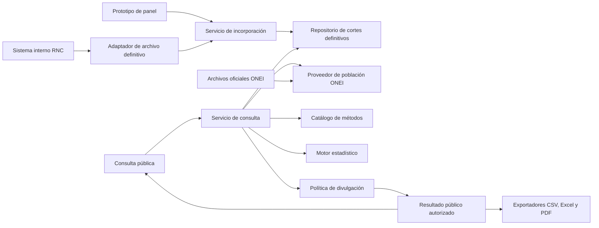

# Arquitectura evolutiva propuesta para la plataforma del RNC

Estado: PROPUESTA DE DISEÑO v1, 2026-10-06. Base: [línea de requisitos](../05-requisitos/linea-base-practicas-ii.md), [preguntas pendientes](../05-requisitos/mapa-de-preguntas.md), `SRC-RNC-005` a `SRC-RNC-007`. La arquitectura se concreta con archivos, reglas y evaluación del RNC; no describe una implementación ya existente.

## Decisión arquitectónica

Diseñar un **monolito modular con puertos y adaptadores**. «Monolito» indica un producto desplegable inicial, sin inventar servicios, servidores o redes del RNC. «Modular» indica límites de responsabilidad explícitos. Los puertos son contratos definidos alrededor de los casos de uso; los adaptadores traducen archivos, almacenamiento o interfaces externas a esos contratos. Esta aplicación del patrón sigue el propósito descrito por [Alistair Cockburn](https://alistair.cockburn.us/hexagonal-architecture) y la separación entre núcleo e infraestructura explicada en la [guía oficial de Microsoft](https://learn.microsoft.com/en-us/dotnet/architecture/modern-web-apps-azure/common-web-application-architectures). La elección **no** obliga a usar .NET, microservicios ni una base de datos concreta.

Las flechas muestran flujo lógico, no protocolo ni despliegue. El motor calcula antes de aplicar la política de divulgación. El objeto entregado a la pantalla y a los exportadores es **el mismo resultado autorizado**. Los datos definitivos internos no se hacen públicos por su sola condición de definitivos.

## Qué permanece estable y qué puede cambiar

| Responsabilidad estable | Contrato o modelo | Variación localizada |
|---|---|---|
| Consulta estadística | `ServicioConsulta`, `CriteriosConsulta`, `RespuestaConsulta` | Filtros y presentación pueden crecer sin cambiar el origen de archivos. |
| Recepción de cortes definitivos | `FuenteCorteDefinitivo` y `ServicioIncorporacion` | Hoy archivo Excel/CSV; una conexión autorizada futura sería otro adaptador del mismo contrato. |
| Lectura de casos/conteos | `RepositorioCortesDefinitivos` | El almacenamiento se decide después; el servicio no importa SQL, hojas ni nombres de columnas. |
| Lectura de denominadores | `ProveedorPoblacion` | Una edición ONEI se incorpora con sus metadatos; el motor no lee PDFs o Excel directamente. |
| Métodos estadísticos | `CatalogoMetodologia`, `DefinicionIndicador`, `MotorIndicadores` | Versión de estándar, fórmula, tratamiento de faltantes y redondeo se identifican por indicador. Un cambio de método crea una nueva definición, sin reescribir resultados anteriores. |
| Divulgación | `PoliticaDivulgacion` | Umbral, agrupación o restricción de filtros se acuerdan con el RNC y se aplican a pantalla y descargas. |
| Exportación | `ExportadorResultado` | CSV, Excel y PDF usan el mismo resultado autorizado; un formato nuevo añade un exportador. |

Solo se introduce una interfaz cuando hay una variación conocida o muy probable. El caso de uso y el motor estadístico pueden ser clases concretas; no se crean interfaces vacías para cada clase.

## Contratos mínimos antes de conocer los archivos

### `FuenteCorteDefinitivo`

Entrega `PaqueteDefinitivo` con identificador externo, periodo, procedencia, declaración de estado definitivo, formato, versión de esquema, huella y contenido. El adaptador de archivo lee Excel/CSV **sin corregir registros**. La futura integración con el sistema interno deberá producir el mismo paquete lógico. El mecanismo de entrega todavía se acuerda.

### `ContratoEntrada` y `ConjuntoCanonico`

El `ValidadorContrato` comprueba esquema, tipos, catálogos, cobertura e integridad. Un adaptador traduce el paquete válido a observaciones estadísticas con dimensiones explícitas (`periodo`, `territorio`, `sexo`, `edad o grupo`, `localización`, `conteo`) y declara su **grano** y capacidades. No se fijan aquí columnas ni se afirma que el archivo ya contiene microdatos o agregados. Una entrada agregada no permite consultas más finas que su propio grano; el sistema debe informar esa limitación, nunca desagregar por estimación silenciosa.

Registrar la huella y procedencia del archivo de origen y mantener separada una representación derivada identificada por versión. La conservación del original se definirá con el RNC según el contrato real y la política institucional cubana (`Q-007`, `Q-017`), especialmente si incluyera información personal. La representación de consulta pública se limita a agregados autorizados.

### `ProveedorPoblacion`

Entrega valores ONEI con año, territorio, sexo, edad/grupo, tipo de población, edición y fuente. Los archivos ONEI son una implementación inicial posible; no se deduce del Anuario Demográfico 2024 que exista toda la matriz municipal por edad simple. Una tasa exige denominador del mismo estrato que el numerador. Si falta, **solo ese indicador** queda indisponible con motivo documentado; un conteo válido puede seguir consultándose si la política de divulgación lo permite.

### `CatalogoMetodologia` y `PoliticaDivulgacion`

Cada `DefinicionIndicador` conserva identificador, versión, unidad, universo, fórmula, estándar de ajuste cuando aplique, redondeo y fuente. La referencia de trabajo para ASR(W) es Segi/Doll de IARC/CI5; se comprobará con un ejemplo RNC. La política de divulgación recibe el resultado calculado y los filtros y produce un `ResultadoConsulta` autorizado o una razón de indisponibilidad. Su versión debe acompañar cada salida. Una política aún no aprobada no se codifica como un umbral inventado.

## Flujos y reglas que preservan el diseño

1. **Incorporar:** recibir paquete definitivo → comprobar contrato técnico → registrar procedencia/huella → derivar el conjunto canónico sin alterar el origen → habilitar las capacidades que permiten sus datos. Un archivo incompatible se rechaza técnicamente. Falta de ONEI no cambia el estado definitivo del archivo; afecta los indicadores que dependen de ese denominador.
2. **Consultar:** validar filtros y capacidad/grano → obtener conteos definitivos → solicitar denominadores y definiciones de los indicadores elegidos → calcular solo los indicadores posibles → aplicar política de divulgación al resultado agregado → entregar `ResultadoConsulta` o explicación. Cada tasa identifica corte RNC, edición ONEI, método, estándar y unidad.
3. **Exportar:** partir del mismo `ResultadoConsulta` mostrado; convertir formato sin recalcular ni recuperar datos crudos. CSV, Excel y PDF respetan idénticas restricciones y metadatos.

## Escenarios de cambio previstos

| Si cambia… | Se revisa principalmente… | Comprobación necesaria |
|---|---|---|
| La plantilla XLSX/CSV | Adaptador de archivo y contrato de esquema | Mismo paquete lógico y conteos; rechazo claro de esquema incompatible. |
| El origen pasa de archivo a conexión autorizada | Nuevo adaptador `FuenteCorteDefinitivo` | El caso de uso de consulta y las fórmulas reciben los mismos datos lógicos. |
| ONEI publica otra edición o desagregación | Adaptador/proveedor de población y metadatos de versión | Alineación de estratos y reproducción de tasas anteriores. |
| El RNC define otro porcentaje o ajuste indirecto | Nueva versión de `DefinicionIndicador` y cálculo correspondiente | Resultado de referencia, unidad, universo y redondeo explícitos. |
| Se acuerda la política de celdas pequeñas | Implementación/versionado de `PoliticaDivulgacion` | Pantalla y tres exportaciones producen el mismo resultado autorizado; probar inferencias entre filtros. |
| Se añade un filtro o formato | Contrato de consulta o un exportador | Compatibilidad con grano de datos, política y metadatos. |

## Límites conscientes

- No se diseña una entidad física `CasoTumor` ni claves de base de datos antes de conocer el grano real de entrada.
- No se incluye el flujo clínico de corrección, deduplicación y cierre que ya ejecuta el sistema interno.
- No se elige hoy framework, motor de base de datos, topología de despliegue, protocolo de integración ni esquema de permisos del panel seguro.
- No se vuelven configurables por una pantalla las reglas epidemiológicas fundamentales. Cambiarlas exige versión, fuente, revisión y pruebas.

Este documento dirige `CMP-01`, `CD-01`, `CD-03`, `SD-01`, `SD-02` y `ACT-01`. La [guía de dibujo](plan-operativo-diagramas-staruml.md) debe mostrar los contratos y la frontera entre dato definitivo interno y resultado público.
