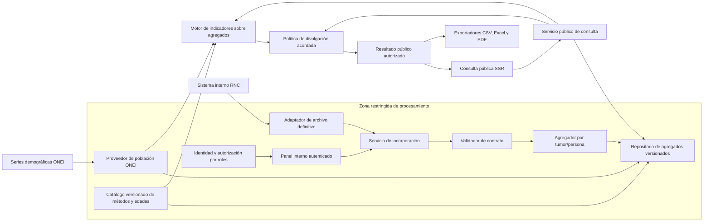

# Arquitectura evolutiva propuesta para la plataforma del RNC

Estado: PROPUESTA DE DISEÑO v3, 2026-10-15. Base: [línea de requisitos](../05-requisitos/linea-base-practicas-ii.md), [preguntas pendientes](../05-requisitos/mapa-de-preguntas.md), `SRC-RNC-005` a `SRC-RNC-010`, `SRC-PRJ-001`, `EVD-092` a `EVD-100`, `DEC-011`. La arquitectura se concreta con el contrato autorizado, reglas y evaluación del RNC; no describe una implementación validada.

## Decisión arquitectónica

Diseñar un **monolito modular con puertos y adaptadores**. «Monolito» indica un producto desplegable inicial, sin inventar servicios, servidores o redes del RNC. «Modular» indica límites de responsabilidad explícitos. Los puertos son contratos definidos alrededor de los casos de uso; los adaptadores traducen archivos, almacenamiento o interfaces externas a esos contratos. Esta aplicación del patrón sigue el propósito descrito por [Alistair Cockburn](https://alistair.cockburn.us/hexagonal-architecture) y la separación entre núcleo e infraestructura explicada en la [guía oficial de Microsoft](https://learn.microsoft.com/en-us/dotnet/architecture/modern-web-apps-azure/common-web-application-architectures). La elección **no** obliga a usar .NET, microservicios ni una base de datos concreta.

Las flechas y zonas expresan límites lógicos, no servidores ni topología de despliegue. La propuesta separa la entrada restringida de las publicaciones agregadas: los archivos fuente pueden contener nombres, identificadores y datos clínicos, y el estudiante aclaró que cada fila corresponde a un tumor [SRC-RNC-010]. La zona pública consulta únicamente agregados autorizados; no tiene acceso al archivo fuente ni a claves personales. La implementación física de esta frontera, almacenamiento, conservación y separación de credenciales debe acordarse con RNC/CUJAE antes de procesar datos reales. La consulta aplica también controles de divulgación a filtros y descargas para reducir inferencias entre resultados. El objeto entregado a pantalla y exportadores es el mismo `ResultadoConsulta` autorizado. Un corte definitivo no queda autorizado a publicación por esa condición solamente.

La identidad administrativa es un módulo transversal del backend: cuentas individuales autenticadas, autorización en servidor mediante permisos/grupos extensibles y un rol `superadmin` de soporte obligatorio en la solución objetivo (`SRC-PRJ-001`). La navegación puede ocultar acciones no autorizadas por comodidad, pero cada URL y operación debe volver a comprobar permisos en servidor. No habrá alta pública de cuentas. El diseño debe poder incorporar roles operativos y de revisión después sin codificar decisiones de autorización dentro de las plantillas. La correspondencia de cuentas con identidad institucional, recuperación de acceso, MFA, asignación de roles y segregación de funciones deben validarse con RNC/CUJAE.

### PWA de consulta pública y modo offline — propuesta 2026-10-19

Se propone una PWA instalable exclusivamente para consulta pública. Su alcance offline podrá generar gráficos con un paquete explícito de **agregados aprobados para publicación**, identificado por corte/versión y fecha de descarga. No incluirá rutas ni funciones administrativas, sesión/token administrativo, microdatos, resultados restringidos ni páginas autenticadas. El panel continúa en la web online. Se recomienda alojar la PWA en un origen separado o, si comparte origen, restringir el `scope` del service worker al cliente público y excluir rutas/respuestas privadas. Las operaciones administrativas requieren conexión, sesión y autorización en el servidor.

No usar `navigator.onLine` ni una hora sin conexión como control de acceso. La señal online no asegura conectividad con el portal. La interfaz puede combinar errores de solicitudes reales con timeouts/reintentos para indicar conexión intermitente; si no logra conectar, bloquea operaciones administrativas y ofrece el conjunto público guardado, claramente marcado como offline con su corte y fecha de descarga. Una hora podría evaluarse únicamente como señal visual de conexión envejecida; no define vigencia estadística ni borra un paquete público. En modo offline no se conoce una revocación/actualización, y no se pueden retirar los datos guardados hasta que el dispositivo reconecte. El paquete y los cálculos locales requieren controles de divulgación, tamaño acotado y prueba de equivalencia con salidas aprobadas.

Los recursos públicos estáticos pueden precachearse. Respuestas autenticadas/sensibles quedan fuera de Cache API; además se envían directivas HTTP `no-store` donde corresponda. `no-store` no controla la caché programática de un service worker, que debe excluir expresamente dichas respuestas y limpiar entradas anteriores. La propuesta se apoya en MDN/OWASP (`SRC-TECH-026`) y requiere implementación, pruebas con conectividad intermitente, comprobación por navegador/plataforma y validación de despliegue. Trazabilidad: `SRC-RNC-012` → `EVD-116..117`; alcance offline pendiente `Q-025`.

## Persistencia, archivos y operación institucional

La base de datos relacional propuesta conserva cuentas/grupos/permisos, metadatos de importación, cortes y versiones, procedencia/huella, catálogos y definiciones versionadas, autorizaciones/publicaciones, referencias al almacenamiento privado y eventos de auditoría. Las hojas fuente no se guardan como blobs ni se sirven desde el directorio web: un almacenamiento privado con permisos mínimos conserva el original autorizado y derivados restringidos; la base registra un identificador interno opaco del objeto y su huella, nunca una ruta navegable pública. El acceso a originales queda limitado a tareas backend autorizadas. PostgreSQL sigue siendo candidato productivo, no selección institucional cerrada (`DEC-010`).

El monorepo debe conservar un solo producto desplegable, con carpetas explícitas para backend por dominio y frontend (plantillas, estilos, JavaScript y recursos), además de infraestructura/despliegue y documentación. No implica una SPA ni dos servicios: se mantiene renderizado HTML desde servidor para limitar tráfico en conectividad baja. La estructura objetivo y responsabilidades se detallan en `rnc-web/docs/ARQUITECTURA-OBJETIVO-OPERACION.md`; mover carpetas existentes es una tarea de implementación aparte.

El despliegue objetivo es en infraestructura autorizada por RNC/CUJAE, con proxy inverso HTTPS, servidor de aplicación, base relacional, archivos privados persistentes y secretos fuera del repositorio. El diagrama actual es lógico; no inventa cantidad de servidores, sistema operativo ni proveedor. Definir ambiente de pruebas/producción, red, responsables y actualizaciones al obtener restricciones institucionales.

Los respaldos deben cubrir consistentemente base de datos y objetos originales/metadatos, estar cifrados y protegidos con credenciales separadas, tener retención aprobada y ensayarse mediante restauraciones. RPO/RTO, frecuencia, ubicación secundaria, retención y custodia se mantienen pendientes; una copia sin prueba de restauración no demuestra recuperabilidad. El caché solo puede reutilizar resultados agregados públicos autorizados, con clave que incluya filtros normalizados y versiones de corte, método y política; publicación, sustitución o revocación invalida las entradas afectadas. Nunca cachear páginas autenticadas o respuestas con información restringida en un caché compartido.

## Qué permanece estable y qué puede cambiar

| Responsabilidad estable | Contrato o modelo | Variación localizada |
|---|---|---|
| Consulta estadística | `ServicioConsulta`, `CriteriosConsulta`, `RespuestaConsulta` | Filtros y presentación pueden crecer sin cambiar el origen de archivos. |
| Recepción de cortes definitivos | `FuenteCorteDefinitivo` y `ServicioIncorporacion` | Hoy archivo Excel/CSV; una conexión autorizada futura sería otro adaptador del mismo contrato. |
| Unidad de análisis y conteo | `AgregadorUnidadEstadistica`, `ModoConteo`, `ContratoEntrada.grano` | El archivo se comunica como una fila por tumor; el conteo de personas requiere una clave autorizada. Nunca se deduce la clave desde el nombre de la columna. |
| Identidad y autorización administrativa | `ServicioIdentidad`, cuenta individual, permisos por rol | Obligatorio en la solución objetivo; `superadmin` existe como rol de soporte y los demás se añaden por configuración. El backend autoriza cada operación. Proveedor institucional y ciclo de vida de cuentas quedan por validar. |
| Lectura de datos restringidos | `RepositorioRestringido` | Se limita al procesamiento autorizado; acceso público separado. Formato, almacenamiento y retención dependen de la política institucional. |
| Registro y almacenamiento de archivos | `RegistroImportacion`, `AlmacenPrivado` | BD guarda procedencia, estado, versión, huella y referencia opaca; archivo original queda fuera de rutas públicas y con acceso backend restringido. Política de retención pendiente. |
| Respaldo y recuperación | `PlanRecuperacion` operativo | Copias coordinadas de BD y almacenamiento de archivos, cifrado y restauraciones periódicas. RPO/RTO y retención por acordar. |
| Publicación de datos | `RepositorioAgregadosPublicables` | Solo recibe agregados después de controles y autorización; conserva corte, versión de método y divulgación. |
| Lectura de denominadores | `ProveedorPoblacion` | Una edición ONEI se incorpora con tipo (media/efectiva), año, sexo, territorio, edad simple, cobertura y fuente. Las tabulaciones adicionales están disponibles a quien las requiera según el Anuario; el canal/matriz exacta aún debe localizarse. |
| Métodos estadísticos | `CatalogoMetodologia`, `DefinicionIndicador`, `MotorIndicadores` | Versión de estándar, fórmula, tratamiento de faltantes y redondeo se identifican por indicador. Un cambio de método crea una nueva definición, sin reescribir resultados anteriores. |
| Divulgación | `PoliticaDivulgacion` | Umbral, agrupación o restricción de filtros se acuerdan con el RNC y se aplican a pantalla y descargas. |
| Exportación | `ExportadorResultado` | CSV, Excel y PDF usan el mismo resultado autorizado; un formato nuevo añade un exportador. |

Solo se introduce una interfaz cuando hay una variación conocida o muy probable. El caso de uso y el motor estadístico pueden ser clases concretas; no se crean interfaces vacías para cada clase.

## Contratos mínimos antes de conocer los archivos

### `FuenteCorteDefinitivo`

Entrega `PaqueteDefinitivo` con identificador externo, periodo, procedencia, declaración de estado definitivo, formato, versión de esquema, huella y contenido. El adaptador de archivo lee Excel/CSV **sin corregir registros**. La futura integración con el sistema interno deberá producir el mismo paquete lógico. El mecanismo de entrega todavía se acuerda.

### `ContratoEntrada` y `ConjuntoCanonico`

El `ValidadorContrato` comprueba esquema, tipos, catálogos, cobertura e integridad. La aclaración del estudiante informa que el grano de la tabla recibida es **una fila por tumor** y que existen identificadores para reconocer a la persona [SRC-RNC-010]. Se registra como unidad comunicada, a verificar contra el diccionario y el contrato autorizado antes de producción. El adaptador deriva una observación lógica con dimensiones validadas y una referencia restringida a tumor/persona; nunca expone las claves a la zona pública. `AgregadorUnidadEstadistica` ofrece, cuando haya clave aprobada, modos explícitos de conteo por tumor y por persona. La agregación por persona puede solaparse entre localizaciones si una persona tiene tumores múltiples; los porcentajes deben declarar el universo y la unidad.

El modelo lógico puede representar `TumorRegistrado` y `PersonaRegistrada` como conceptos con relación uno a muchos, sin decidir aún tablas, claves o campos físicos. Si una entrega futura fuera ya agregada, el contrato deberá declarar ese grano y capacidades y no permitir consultas más finas que la información recibida; nunca desagregar por estimación silenciosa.

Registrar huella y procedencia del origen y mantener derivaciones identificadas por versión. Si el archivo contiene datos personales, conservarlo y procesarlo únicamente en la zona restringida y según autorización/retención institucional. La zona pública contiene agregados autorizados y metadatos de publicación, nunca nombres, identificadores ni filas de tumores. La política de retención y la separación física de almacenamiento siguen pendientes (`Q-007`, `Q-017`).

### `ProveedorPoblacion`

Entrega valores ONEI con año, territorio, sexo, edad simple, tipo de población, edición, fecha/cobertura y fuente. El Anuario Demográfico 2024 ofrece cuadros resumidos y declara tabulaciones/bases adicionales disponibles para solicitud; la descarga abierta o el procedimiento concreto para la matriz de interés no se ha identificado. Debe permitir incorporar una edición conforme se publique, no depender de una cadencia fija. La tasa exige un denominador compatible con numerador y periodo. Si falta, solo ese indicador queda indisponible con motivo documentado; un conteo autorizado puede seguir disponible.

### `CatalogoMetodologia` y `PoliticaDivulgacion`

Cada `DefinicionIndicador` conserva identificador, versión, unidad (tumor/persona), universo, fórmula, tratamiento de desconocidos, redondeo y fuente. El Manual RNC confirma el uso de frecuencias absolutas y relativas, pero no se ha identificado una fórmula única para todas las consultas. La referencia de trabajo para ASR(W) es Segi/Doll de IARC/CI5; se comprobará con un ejemplo RNC. Los intervalos de confianza son una propuesta del proyecto: cada método/nivel debe versionarse y atribuirse como cálculo del sistema hasta validación RNC. `AgrupacionEdad` conserva versión y límites. La agrupación clásica queda estable; los nomencladores adicionales pueden definirse de forma independiente, aunque las tasas solo se habilitan si denominadores y pesos estándar admiten una correspondencia válida. La política de divulgación recibe resultado y filtros y produce un `ResultadoConsulta` autorizado o una razón de indisponibilidad; su versión acompaña cada salida. No se codifica un umbral de supresión sin acuerdo institucional.

## Flujos y reglas que preservan el diseño

1. **Incorporar:** recibir archivo definitivo en el entorno restringido → comprobar contrato técnico y unidad comunicada → registrar procedencia/huella → derivar conteos sin alterar el origen → comprobar cobertura y capacidades → revisar divulgación → publicar una versión agregada. Un archivo incompatible se rechaza técnicamente. Falta de ONEI no cambia el estado definitivo del origen; afecta los indicadores dependientes del denominador.
2. **Consultar:** validar filtros y capacidad/grano → obtener conteos definitivos → solicitar denominadores y definiciones de los indicadores elegidos → calcular solo los indicadores posibles → aplicar política de divulgación al resultado agregado → entregar `ResultadoConsulta` o explicación. Cada tasa identifica corte RNC, edición ONEI, método, estándar y unidad.
3. **Exportar:** partir del mismo `ResultadoConsulta` mostrado; convertir formato sin recalcular ni recuperar datos crudos. CSV, Excel y PDF respetan idénticas restricciones y metadatos.

## Escenarios de cambio previstos

| Si cambia… | Se revisa principalmente… | Comprobación necesaria |
|---|---|---|
| La plantilla XLSX/CSV o el grano | Adaptador y contrato de esquema/unidad | Mismo contrato lógico; rechazo de esquema incompatible; no confundir conteo de filas, tumores y personas. |
| El origen pasa de archivo a conexión autorizada | Nuevo adaptador `FuenteCorteDefinitivo` | El caso de uso de consulta y las fórmulas reciben los mismos datos lógicos. |
| ONEI publica otra edición o desagregación | Adaptador/proveedor de población y metadatos de versión | Alineación de estratos y reproducción de tasas anteriores. |
| El RNC define otro porcentaje o ajuste indirecto | Nueva versión de `DefinicionIndicador` y cálculo correspondiente | Resultado de referencia, unidad, universo y redondeo explícitos. |
| Se acuerda la política de celdas pequeñas | Implementación/versionado de `PoliticaDivulgacion` | Pantalla y tres exportaciones producen el mismo resultado autorizado; probar inferencias entre filtros. |
| ONEI cambia edición, método o desgloses | `ProveedorPoblacion` y metadatos de publicación | Reproducir indicadores con la edición correcta, distinguir población media de efectiva y conservar versiones anteriores. |
| El RNC cambia la cadencia de entregas | Orquestación versionada de incorporación/publicación | Admitir carga repetible semanal o anual, idempotencia, reemplazo/revocación trazable y recuperación del último corte válido. |
| Se añade un filtro o formato | Contrato de consulta o un exportador | Compatibilidad con grano de datos, política y metadatos. |

## Límites conscientes

- El concepto de una fila por tumor y persona agrupadora está comunicado (`SRC-RNC-010`); claves/tablas físicas esperan autorización y diccionario.
- No se incluye el flujo clínico de corrección, deduplicación y cierre que ya ejecuta el sistema interno.
- Django y PostgreSQL siguen siendo candidatos, no decisiones de despliegue aprobadas. No se fija topología institucional, proveedor de identidad ni matriz completa de permisos. Sí se establece como dirección del producto autenticación individual extensible y rol `superadmin` (`SRC-PRJ-001`); debe concretarse con RNC/CUJAE.
- No se vuelven configurables por una pantalla las reglas epidemiológicas fundamentales. Cambiarlas exige versión, fuente, revisión y pruebas.

Este documento dirige `CMP-01`, `CD-01`, `CD-03`, `SD-01`, `SD-02` y `ACT-01`. La [arquitectura objetivo de operación del monorepo](../../../rnc-web/docs/ARQUITECTURA-OBJETIVO-OPERACION.md) detalla login/roles, estructura, despliegue, archivos privados, copias/restauración y caché. La [guía de dibujo](plan-operativo-diagramas-staruml.md) debe mostrar los contratos y la frontera entre dato definitivo interno y resultado público.
