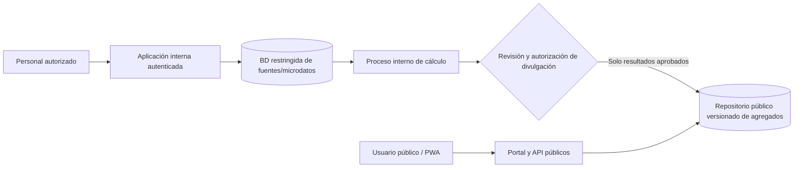

# DEC-015 — Separación de datos sensibles y consulta pública

**Estado:** propuesta de arquitectura con prototipo local sintético implementado; no validada institucionalmente.
**Fecha:** 2026-10-20
**Trazabilidad:** `SRC-PRJ-005`, `SRC-PRJ-007` → `EVD-125..128`, `EVD-132` → `Q-027`; relacionada con `DEC-007`, `DEC-011`, `Q-007` y `Q-022`.

## Valoración

La separación entre el manejo de microdatos y la publicación pública es factible, coherente con el propósito estadístico del portal y recomendable como defensa en profundidad. Reduce el impacto probable de una exposición en la interfaz pública si el cliente público no tiene ruta, credenciales ni permisos para leer la base clínica. No elimina todos los riesgos ni constituye por sí misma una garantía de confidencialidad.

La expresión «la capa pública hace peticiones a la privada» requiere precisar el destino de esas peticiones. No se recomienda que el navegador ni el backend público consulten directamente registros clínicos para responder filtros arbitrarios. Una API puede devolver propiedades internas por error o permitir combinaciones que infieran casos. OWASP recomienda validar en servidor cada propiedad expuesta y responder solo lo que el consumidor necesita (`EVD-127`). NIST señala que la ubicación dentro de una red no debe otorgar confianza implícita; se necesitan controles de identidad, recurso y flujo (`EVD-126`).

## Flujo recomendado para estudiar

El portal/API público consulta únicamente el repositorio de resultados liberados, con respuestas limitadas a los campos y métricas aprobados. La publicación fluye desde la zona restringida a la pública después de una operación separada de revisión/autorización. Los servicios y cuentas públicas no reciben credenciales de la BD clínica. Se pueden evaluar límites de red y servicios separados; esta propuesta no exige que cada caja sea una máquina distinta y no fija todavía proveedor, red o modelo físico.

## Ubicación de la administración

La gestión de usuarios/roles, recepción de archivos, revisión técnica y autorización de cortes pertenece a la aplicación interna de la zona restringida. Solo el personal autorizado accede por el canal que defina la institución (por ejemplo, red institucional o acceso remoto controlado); ese mecanismo no se decide aquí. El servicio público no ofrece esas rutas ni comparte credenciales administrativas. El administrador prepara y libera una versión aprobada; el flujo de publicación copia únicamente el conjunto autorizado al repositorio público.

Se puede conservar un monorepo y reutilizar modelos o lógica de dominio, pero ejecutar dos despliegues/configuraciones con rutas, identidades de servicio y permisos de datos separados. Poner un proxy delante del mismo proceso y base de datos mejora la entrada de red, pero no crea por sí solo esta frontera de privilegios.

`rnc-web` ahora incluye un primer prototipo local de ese flujo, limitado a datos sintéticos. Al publicar, el servicio administrativo agrega las filas en un cubo versionado que no conserva IDs de persona/tumor; el servicio público lo lee desde `RNC_PUBLIC_RELEASE_ROOT`. `config.settings_admin` incluye autenticación, modelos, rutas de gestión y almacenamiento privado. `config.settings_public` limita rutas a Inicio/Consulta, no instala los modelos de administración, establece un backend de base de datos `dummy` y no configura almacenamiento privado. El directorio de agregados se comparte entre procesos; el perfil público debe montarlo como solo lectura. El perfil predeterminado de desarrollo conserva ambas áreas y no constituye una separación de despliegue. No se ha desplegado a una infraestructura compartida (`EVD-132`).

El 20-10-2026 se ejecutó el recorrido automatizado de carga sintética, publicación administrativa, consulta del perfil público y revocación; también pasó la suite Django completa (58 pruebas). La prueba usa BD y archivos temporales, simula la configuración pública y verifica que las rutas administrativas no estén disponibles y que el artefacto no incluya IDs. Esto comprueba el prototipo local, no dos procesos desplegados, no constituye auditoría de seguridad y no valida una política RNC de divulgación (`EVD-132`).

El cubo precomputa márgenes por las combinaciones de período, territorio, sexo, edad y grupo ilustrativo. Así preserva los conteos sintéticos de personas distintas para consultas que combinan años sin entregar identificadores. También contiene muchos agregados solapados y permite conteos exactos en categorías pequeñas; por tanto, no es una política de publicación segura ni debe alimentarse con datos RNC. Supresión, riesgo de inferencia, tamaño/rendimiento del paquete y evolución del esquema siguen abiertos bajo `Q-007`/`Q-027`. La implementación demuestra la separación del lector y el flujo de publicación, no valida el contrato estadístico institucional.

Si se necesita una API dinámica, deberá leer resultados que ya pasaron por el proceso de liberación, o implementar un servicio mediador con catálogo cerrado de consultas aprobadas y controles equivalentes. En ese segundo caso hay una dependencia en tiempo real de la zona interna y mayor superficie de ataque, carga operativa y riesgo de inferencia; no debe ser la opción predeterminada. Aun sobre agregados, quedan por resolver celdas pequeñas, diferencias entre consultas repetidas, filtros combinados, fechas/territorios raros y descargas masivas según `Q-007`.

Los conteos de personas distintas y filtros que combinan varios años añaden un requisito estadístico: habría que precomputar y publicar agregados suficientes para las consultas admitidas, o diseñar un servicio mediador con límites de divulgación. No se deben inferir registros individuales desde el paquete. La política de celdas pequeñas y combinaciones seguras es previa a decidir ese contrato (`Q-007`, `Q-027`).

## Qué mejora y qué no

- **Mejora:** contiene privilegios, limita el camino entre Internet y la base clínica, permite publicar datos sin incluir la administración y reduce la cantidad de sistemas que manejan identificadores individuales.
- **No resuelve por sí sola:** autorización institucional, errores de implementación/API, reidentificación por agregados, robo de cuentas internas, filtración en logs/respaldos, riesgo de terceros ni disponibilidad del servicio.
- **Costos:** más procesos de publicación/versionado, servicios y contratos que operar, administración de credenciales, monitoreo y posibles demoras entre cálculo y actualización pública. El flujo debe conservar corte, versión, fecha y procedencia.

La guía de confidencialidad IACR/IARC recomienda agregados/anónimos para muchos usos estadísticos y advierte de la identificación indirecta al combinar edad, sexo y áreas pequeñas (`SRC-IARC-CONF-2004`). Es orientación internacional; el contenido divulgable, los controles de supresión y las responsabilidades deben definirse con el RNC bajo las normas cubanas. El Manual RNC VII, la Ley 149/2022 y la Resolución 58/2022 siguen siendo referencias cubanas del proyecto; la política específica del nuevo portal continúa pendiente (`Q-007`).

## Próximas decisiones

Validar con RNC/CUJAE los roles que revisan y autorizan la publicación, los filtros/indicadores permitidos, la política estadística y controles contra inferencia, además de infraestructura de ensayo/producción, retención y copias. Resolver `Q-007`/`Q-027` antes de generar agregados con datos reales. No se conectan fuentes clínicas por este prototipo.
