# Plataforma web interactiva para consultar estadísticas del Registro Nacional de Cáncer de Cuba

**Borrador de informe de Prácticas II y base del trabajo de diploma**  
Autor: Danny Fiallo Muñoz  
Facultad de Ingeniería Informática, Universidad Tecnológica de La Habana «José Antonio Echeverría»  
Corte documental: 13 de octubre de 2026  
Estado: borrador de trabajo; revisar título, tutoría, problema, objetivos y estructura con los tutores antes de entregar.

> Este es el texto maestro editable. Los pasajes marcados **PENDIENTE** requieren resultados propios, datos del RNC o una decisión de tutoría. Las referencias entre corchetes siguen una numeración provisional uniforme; antes de la entrega se normalizarán todos los metadatos en el estilo acordado. El material de `rnc-research` permite fundamentar el documento, pero no reemplaza la validación de métodos ni los resultados del software.

## Resumen y Abstract

**PENDIENTE DE RESULTADOS.** La guía académica [15] pide un resumen en español y otro en inglés, de hasta 250 palabras, con necesidad, objetivo, resultados e importancia. Redactarlos cuando existan resultados verificables; no anticipar que la plataforma ya fue implementada o evaluada.

## Introducción

El Registro Nacional de Cáncer (RNC) de Cuba es un registro poblacional de alcance nacional que reúne información sobre tumores diagnosticados en residentes permanentes. Su manual de procedimientos describe una red de unidades informantes, estructuras territoriales y una oficina central que revisa, valida, consolida y analiza los datos [3]. Las estadísticas resultantes apoyan el conocimiento epidemiológico del cáncer, la planificación sanitaria y la investigación [1], [3].

La Propuesta de Trabajo del proyecto identifica una limitación en la forma de difusión: los resultados disponibles se consultan principalmente mediante documentos PDF, lo que dificulta combinar dinámicamente año, territorio, sexo, edad y localización tumoral para responder preguntas específicas [1]. El Anuario Estadístico de Salud 2024 muestra que Cuba ya publica conteos y tasas de incidencia, incluidas tasas ajustadas por edad, pero las cifras de incidencia de 2022 allí recogidas están marcadas como preliminares [5]. La futura plataforma pública, según la dirección actual del proyecto, consultará exclusivamente cortes identificados como definitivos [17].

La necesidad de consulta dinámica tiene antecedentes internacionales, aunque esos sistemas responden a poblaciones y métodos propios. SEER*Explorer permite obtener gráficos, tablas y descargas a partir de dimensiones estadísticas [6]; Cancer Today facilita comparaciones internacionales mediante distintas visualizaciones [7]; ECIS distingue series históricas observadas de estimaciones y proyecciones [8]. Estos ejemplos orientan el diseño, pero sus poblaciones estándar, clasificaciones, reglas de publicación y métodos de cálculo no se trasladan automáticamente al RNC cubano.

**Situación problemática documentada.** Existe información epidemiológica oficial, pero la vía de publicación descrita en la propuesta limita la exploración interactiva y la obtención de resultados según combinaciones de variables de interés [1]. Para desarrollar una alternativa confiable hay que preservar la definición cubana de caso, la correspondencia entre casos y población, la confidencialidad de los registros individuales y la trazabilidad de los cortes publicados [3], [17], [18]. Ya se dispone de una muestra que permite documentar la estructura estable del CSV; aún faltan los cortes definitivos autorizados para el desarrollo, el diccionario semántico, las series ONEI detalladas y ejemplos oficiales de cálculo con que comprobar la aplicación de la estándar mundial.

**Problema de investigación propuesto; validar con tutores.** ¿Cómo facilitar la consulta pública e interactiva de estadísticas definitivas del RNC de Cuba y el cálculo reproducible de indicadores de incidencia a partir de datos y reglas aprobados por el registro?

**Objeto de estudio propuesto; validar con tutores.** La difusión y el análisis de estadísticas de registros poblacionales de cáncer mediante sistemas informáticos.

**Campo de acción propuesto; validar con tutores.** El diseño de una plataforma web para consultar y calcular estadísticas agregadas de incidencia del RNC de Cuba.

**Objetivo general del proyecto.** Desarrollar una plataforma web interactiva para consultar estadísticas de incidencia del RNC y calcular tasas crudas, específicas y ajustadas, de acuerdo con los datos y métodos aprobados [1], [2]. El verbo y el alcance exactos del objetivo académico deben acordarse con los tutores.

**Objetivos específicos de trabajo, propuestos para el informe:**

1. Caracterizar el proceso estadístico del RNC, los indicadores necesarios y las soluciones comparables.
2. Definir los requisitos y el diseño de la plataforma a partir de las fuentes cubanas y la validación con especialistas.
3. Desarrollar el núcleo de consulta, cálculo y exportación previsto para Prácticas II.
4. Evaluar la corrección de los cálculos y la adecuación de las funciones implementadas mediante casos verificables.

**Tareas del trabajo, organizadas para hacer verificables los objetivos y sujetas al calendario del Anexo A [2]:**

| Objetivo | Tareas asociadas | Evidencia que se documentará |
|---|---|---|
| 1 | 1.1 Analizar el proceso del RNC, sus publicaciones y conceptos epidemiológicos. 1.2 Comparar plataformas y estudios pertinentes, identificando aportes y límites. | Capítulo 1: síntesis del Manual, definiciones, análisis crítico del benchmark y preguntas abiertas. |
| 2 | 2.1 Precisar requisitos funcionales y de calidad a partir de fuentes y reuniones. 2.2 Elaborar el modelo conceptual y las vistas de diseño. 2.3 Comparar tecnologías y construir prototipos de consulta y administración. | Capítulo 2: matriz trazable de requisitos, diagramas, prototipos, comparación y decisiones justificadas. |
| 3 | 3.1 Implementar las capacidades previstas de cálculo, consulta, frecuencias y exportación, de acuerdo con reglas y datos disponibles. | Capítulo 3: descripción de componentes y versión realmente desarrollada. |
| 4 | 4.1 Diseñar y ejecutar casos de verificación con resultados de referencia aprobados. 4.2 Evaluar las tareas de los prototipos según perfiles y criterios acordados. | Capítulo 3: escenarios, parámetros, resultados observados, incidencias y límites de la evaluación. |

La tabla organiza el plan documental; no declara que las tareas estén concluidas. La implementación segura del panel, la migración histórica y las pruebas integrales de seguridad, rendimiento y usabilidad pertenecen a etapas posteriores según el Anexo. El prototipo administrativo sí forma parte del diseño de Prácticas II.

**Valor práctico esperado.** Una consulta pública que presente estadísticas definitivas con filtros, contexto metodológico y opciones de exportación puede reducir el trabajo manual necesario para explorar las tablas actuales. Es un valor esperado del proyecto; su magnitud solo podrá afirmarse después de evaluar el producto con usuarios y datos reales.

El informe se organiza en tres capítulos. El primero expone fundamentos del registro, indicadores, publicaciones y referentes de diseño. El segundo describe requisitos y la solución propuesta. El tercero documentará la implementación y la validación realmente realizadas durante la práctica. La estructura puede ajustarse con los tutores conforme a la guía académica [15].

# Capítulo 1. Fundamentos y antecedentes

## Introducción del capítulo

Se presentan los conceptos y fuentes necesarios para diseñar la plataforma: el proceso del RNC, las medidas de incidencia, la naturaleza de los datos publicados, las experiencias de otros sistemas y los criterios de usabilidad y accesibilidad. La revisión delimita qué afirmaciones son reglas documentadas de Cuba y cuáles son patrones externos por evaluar.

## 1.1. El registro poblacional y el proceso cubano

El Manual de Procedimientos del RNC, versión VII de 2024, describe un registro poblacional que integra reportes de distintas fuentes sanitarias y territoriales. Las unidades informantes notifican tumores; los niveles territoriales revisan y completan la información; y la oficina central realiza controles, consolida los registros y prepara estadísticas. El proceso documentado incluye codificación, evaluación de completitud y consistencia, búsqueda de duplicados y múltiples primarios, pareamiento con mortalidad y cierres periódicos [3]. Esta descripción se toma como evidencia de la versión VII; el RNC debe confirmar si continúa vigente para el trabajo.

Esta cadena establece una frontera importante para el proyecto. La plataforma propuesta es una capa de consulta y difusión de estadísticas provenientes de cortes que el sistema interno ya entrega como definitivos. No sustituye el registro, la investigación de casos, la codificación clínica ni la deduplicación. El Anexo A contempla un prototipo de incorporación técnica, mientras que la aclaración del proyecto indica que el portal no debe corregir los casos ni cambiar su estado epidemiológico [2], [18].

La definición del numerador requiere distinguir persona y tumor primario. El Manual describe criterios de registrabilidad y reglas para tumores múltiples; por tanto, contar personas sin considerar esas reglas podría producir un indicador diferente del conteo de tumores del registro [3]. La muestra del CSV no aclara la unidad de cada fila. Aunque su estructura de 84 columnas y su orden se confirmaron estables para futuras entregas, el grano por fila, el diccionario y la relación entre campos continúan sin confirmación [24]. En consecuencia, no se fija aún un modelo lógico o físico de casos.

Para los denominadores, el RNC indicó que suministrará población oficial publicada por ONEI para Cuba, provincias y municipios, desglosada por sexo y edades simples [4]. El Manual menciona población media; el Anuario Demográfico de ONEI distingue población media y efectiva. Se requiere identificar la edición, la referencia temporal y la correspondencia territorial exacta de la serie que se usará. Las tablas públicas revisadas no sustituyen por sí solas la serie detallada que el equipo espera recibir [19].

Las clasificaciones también cumplen funciones diferentes. El Manual indica el uso de CIE-O-3 para topografía y morfología de personas de 20 años o más diagnosticadas desde 2007 y de ICCC-3 para menores de 20 años; las tablas generales del Anuario presentan categorías CIE-10 y las infantiles ICCC-3 [3], [5]. Una interfaz debe declarar qué clasificación y versión sustentan cada filtro o salida. La correspondencia entre códigos de registro y categorías de publicación debe seguir las reglas que confirme el RNC.

La confidencialidad se aplica tanto a los registros fuente como a las salidas. El Manual limita la custodia y comunicación de información nominal; la normativa cubana consultada establece principios de protección de datos personales [3], [20]. La documentación disponible no determina un umbral de supresión para consultas públicas. Por eso, cualquier regla de celdas pequeñas, combinaciones de filtros y exportaciones se considera una decisión institucional pendiente, no un valor que pueda copiarse de un referente extranjero.

## 1.2. Medidas de incidencia y comparabilidad

El Anexo A incluye tasas crudas, específicas por edad, ajustadas por métodos directo e indirecto e intervalos de confianza [2]. Antes de implementarlas, el informe distingue tres denominadores que suelen confundirse: el total de casos que sirve de base a una frecuencia relativa, la población residente usada en una tasa y la población estándar cuyos pesos se usan para el ajuste.

La **frecuencia absoluta** cuenta los casos incluidos en una selección. La **frecuencia relativa** expresa una parte respecto de un universo de casos definido, por ejemplo, casos de una categoría divididos entre el total del conjunto seleccionado. Esa base debe mostrarse y las reglas para desconocidos y categorías no excluyentes deben precisarse. La frecuencia relativa no es una tasa de incidencia.

La **tasa cruda** relaciona el total de casos nuevos con la población correspondiente al mismo periodo y se expresa aquí como tasa anual por 100 000 habitantes:

```text
Tasa cruda = (casos nuevos del periodo / población correspondiente) × 100 000
```

La **tasa específica** aplica la relación dentro de un estrato compatible, por ejemplo, sexo, territorio y grupo de edad:

```text
Tasa específicaᵢ = (casos nuevosᵢ / poblaciónᵢ) × 100 000
```

Estas expresiones son definiciones generales para orientar el análisis. La fecha que determina el año de incidencia, la elección entre población media o efectiva, el manejo de estratos sin denominador y el redondeo aún requieren una especificación reproducible y un ejemplo aceptado por el RNC [3]–[5], [19].

La **estandarización directa por edad** resume tasas específicas aplicándolas a una distribución estándar. Manual RNC y Anuario cubano se refieren a la población estándar mundial [3], [5]. La aclaración del estudiante precisa que la población residente cubana/ONEI proporciona los denominadores y que para cáncer se seguirá la metodología internacional [21]. IARC/CI5 XII documenta la población Segi modificada por Doll, con 18 grupos quinquenales desde 0–4 hasta 85+ y pesos que suman 100 000 [10], [22]. La expresión reproducible es:

```text
ASR = Σ (peso estándarᵢ × casosᵢ / poblaciónᵢ)
```

cuando se usan los pesos absolutos de Segi–Doll y tasas específicas expresadas como casos por persona-año. Equivalentemente, se ponderan las tasas específicas por 100 000 con los pesos normalizados. Casos y población ONEI deben corresponder a los mismos estratos. La estándar no es el denominador de la tasa ni una estimación de la estructura demográfica cubana [10], [22].

La referencia Segi–Doll permite desarrollar y revisar una lógica piloto, pero todavía no autoriza a presentar el resultado como el método validado por el RNC. Se necesita reproducir una cifra cubana con los casos, denominadores, grupos etarios y redondeo usados en la publicación correspondiente. Además, la compatibilidad de edades desconocidas y de grupos nuevos con el estándar debe resolverse explícitamente. Las edades simples de ONEI permiten formar grupos nuevos, pero no justifican subdividir automáticamente un quinquenio de la población estándar [4], [22].

El **ajuste indirecto** forma parte del Anexo, pero las fuentes cubanas consultadas aún no definen qué indicador indirecto, población de referencia, supuestos o interpretación se espera. No se presenta aquí una fórmula cerrada; se requiere una especificación y un ejemplo aprobados antes de implementarlo o compararlo con el método directo [2], [16].

Los **intervalos de confianza** también están en el Anexo como tarea prevista. El Manual y las aclaraciones revisadas no indican un intervalo actualmente publicado por el RNC para las salidas de este producto [3], [18]. CI5 XII proporciona un error estándar para el ASR bajo supuestos de Poisson, pero ese error no determina por sí solo un intervalo. Usar `estimación ± z × error estándar` sería una aproximación normal cuya aplicación a ceros, pocos casos y tasas ajustadas necesita evaluación y acuerdo. La opción Poisson, el método normal, el nivel de confianza y la presentación se mantienen como preguntas abiertas; no se atribuyen al RNC [10], [22].

Las tablas clásicas conservarán los grupos quinquenales de 0–4 a 85+. Se confirmó además la posibilidad funcional de crear agrupaciones adicionales a partir de edades seleccionadas, sin alterar las clásicas [4]. Restan las reglas de intervalos abiertos, solapamiento, selección, permanencia y uso de esos grupos en tasas ajustadas. En esta fase, el diseño debe representar ambas capacidades sin fijar una regla estadística para agrupaciones que todavía no ha sido acordada.

## 1.3. Calidad, oportunidad y naturaleza del dato

El Manual del RNC describe controles de exhaustividad, completitud, validez y consistencia, y documenta indicadores internos de calidad [3]. CI5 XII trata comparabilidad y calidad como condiciones para interpretar estadísticas entre registros [10]. Para esta plataforma conviene separar al menos cuatro etapas que pueden introducir problemas distintos: calidad del proceso de registro, integridad técnica del archivo recibido, corrección de transformaciones/cálculos y claridad de la salida pública.

El archivo estructural observado habilita una comprobación preliminar de codificación, separador, encabezados y orden. No basta para definir reglas de tipo, dominio, campos obligatorios, integridad entre entidades o reconciliación de conteos: se necesita un diccionario autorizado y conocer el grano. Una discrepancia técnica puede impedir la carga, pero la herramienta no debe intentar corregir el contenido clínico. La fuente del corte, fecha, identificador y huella del archivo son metadatos propuestos para poder explicar qué conjunto produjo un resultado; su contrato exacto debe revisarse con el RNC [18], [24].

También deben distinguirse el año de diagnóstico, la fecha de corte/publicación y la fecha de incorporación al portal. El Anuario Estadístico de Salud 2024 presenta la incidencia de 2022 como preliminar [5], mientras la dirección de producto indicó que la plataforma recibirá archivos definitivos [18]. No se ha demostrado que ambos conjuntos correspondan al mismo corte. En consecuencia, una cifra preliminar del Anuario sirve como contexto publicado, no como sustituto automático del archivo definitivo. ECIS aporta un ejemplo de etiquetado diferenciado para datos históricos, estimaciones y proyecciones; sus estados no definen los estados del RNC [8].

## 1.4. Sistemas y estudios comparables

El benchmark se organiza por tareas que una persona puede realizar, naturaleza de los datos y transparencia metodológica. Se examinan soluciones para reconocer patrones de interfaz y riesgos, no para declarar equivalentes sus estadísticas a las del RNC [6]–[9], [14].

| Referente | Aporte observado | Riesgo o límite de transferencia |
|---|---|---|
| SEER*Explorer [6] | Explorar estadísticas con dimensiones, tablas, gráficos, descargas y notas metodológicas. | Población, cobertura, clasificaciones y políticas de EE. UU.; no define filtros ni cálculos cubanos. |
| Cancer Today / GCO [7] | Comparar estadísticas por país, sexo, localización y medida con vistas gráficas y tabulares. Es el referente explícito de visualización señalado para el proyecto [1]. | Sus estimaciones internacionales y métodos no equivalen a los cortes observados y definitivos del RNC. |
| ECIS [8] | Diferenciar observaciones históricas de estimaciones/proyecciones y aportar contexto metodológico. | Sus estados, territorios y métodos no establecen una política cubana. |
| U.S. Cancer Statistics [9] | Notas técnicas, descarga y documentación sobre incertidumbre y supresión. | Sus umbrales de publicación responden a su jurisdicción y no se copiarán para Cuba. |
| CaRDO [14] | Ejemplo de herramienta para que registros publiquen estadísticas poblacionales a partir de una estructura de datos definida. | La compatibilidad con el CSV, grupos, métodos y condiciones institucionales del RNC requiere evaluación antes de escoger tecnología. |

La literatura examinada refuerza que la presencia de visualizaciones no demuestra utilidad. Una revisión exploratoria de 89 publicaciones sobre dashboards de salud pública informó que 42 estaban accesibles durante su revisión y 26 estudios comunicaban una evaluación de usabilidad [12]. Otro estudio analizó 210 dashboards estadounidenses y distinguió usabilidad de utilidad analítica [13]. Esos resultados describen sus respectivas muestras; no son métricas de la futura plataforma cubana. Sí justifican documentar tareas de usuario y evaluar si los resultados pueden encontrarse, interpretarse y exportarse.

La síntesis del benchmark identifica patrones útiles para estudiar: exploración multidimensional, presentación conjunta de tabla y gráfico, notas metodológicas visibles, identificación de la naturaleza/estado de los datos, consideración de pocos casos y evaluación con tareas reales [6]–[9], [12]–[14]. Cada patrón debe convertirse en una pregunta de diseño y contrastarse con necesidades del RNC; por ejemplo, el control de celdas pequeñas debe motivar una consulta institucional, no la adopción del umbral de USCS.

## 1.5. Experiencia de uso, accesibilidad y conectividad

El producto se proyecta como una web pública para perfiles diversos, entre ellos público general, profesionales de salud e investigadores [1], [17]. Estos perfiles no deben confundirse con roles autenticados del panel, que siguen sin especificación. La interfaz debería ayudar a seleccionar filtros, comprender qué población y periodo representa cada resultado, distinguir una frecuencia de una tasa y obtener el resultado en una tabla o descarga. Estas son necesidades derivadas del análisis y deberán priorizarse con tareas observadas o confirmadas por usuarios.

WCAG 2.2 proporciona criterios internacionales de accesibilidad web que orientan el diseño [11]. Aún no se ha acordado nivel de conformidad ni método de evaluación. Como criterios de diseño iniciales se consideran navegación completa por teclado, foco visible, etiquetas asociadas a controles, contraste suficiente, alternativas textuales para gráficos y disponibilidad de la información tabular equivalente. Cada criterio deberá asociarse luego a una comprobación concreta y a un criterio de aceptación.

La conectividad limitada en Cuba es una condición de producto recogida por el proyecto [1], [17]. En esta fase se propone priorizar páginas y gráficos ligeros, evitar descargas innecesarias y ofrecer tablas que sigan siendo útiles cuando una visualización no se cargue. No se fija aún un tiempo objetivo: antes se deben acordar dispositivos, tamaño de datos, infraestructura y perfiles de conexión para que una medición futura sea interpretable.

## 1.6. Síntesis de fundamentos y criterios para la solución

La revisión conduce a criterios de diseño preliminares. Cada uno deberá convertirse en requisito trazable y validarse en la fase correspondiente:

1. Separar la consulta pública y la incorporación técnica de la captura, depuración clínica y decisión de definitividad que realiza el sistema interno.
2. Asociar cada resultado con fuente/corte, periodo, territorio, clasificación, grupo etario, denominador, estándar de ajuste y método aplicable.
3. Preservar las bandas quinquenales clásicas y permitir estudiar agrupaciones adicionales sin inventar reglas de cálculo.
4. Presentar conteos, tasas, unidades y contexto metodológico mediante tabla y visualización accesibles.
5. Comprobar el cálculo con ejemplos aprobados antes de publicar resultados estadísticos.
6. Validar la estructura CSV conocida sin deducir significado o grano desde nombres abreviados de columnas.
7. Separar la validez técnica de un archivo de su autorización de publicación en cada nivel de desglose.
8. Definir con el RNC la protección de resultados, combinaciones de filtros y exportaciones.
9. Diseñar la interfaz para tareas reales, teclado y conectividad limitada, y evaluar el producto con escenarios acordados.

## Conclusiones parciales del capítulo 1

La revisión documental permite describir el proceso del registro y delimitar la plataforma como una capa de consulta de cortes definitivos. También permite fundamentar la distinción entre numerador, población ONEI denominadora y estándar mundial, así como anticipar la necesidad de trazabilidad, accesibilidad y una vista tabular junto con la gráfica. La estructura estable del CSV permite adelantar una validación sintáctica, pero no determina el significado de sus filas o columnas. El método indirecto, la política de intervalos, la temporalidad de los denominadores y la publicación de celdas pequeñas siguen dependiendo de aclaraciones. Por tanto, el capítulo establece fundamentos y criterios de diseño, pero no demuestra todavía la corrección estadística de una implementación.

# Capítulo 2. Requisitos y propuesta de solución

## Introducción del capítulo

Este capítulo traduce el alcance de Prácticas II a una propuesta de solución verificable. Primero delimita qué capacidades pertenecen a esta etapa; después organiza requisitos, datos, arquitectura, prototipos y alternativas tecnológicas. Las figuras muestran el diseño que se está elaborando y se acompañan de explicación textual. La línea base y los diagramas son insumos de trabajo: su aceptación requiere revisión de tutoría y, cuando afecta reglas o procesos del RNC, validación institucional.

## 2.1. Alcance de Prácticas II

El Anexo A [2] plantea para Prácticas II el análisis comparativo, los fundamentos estadísticos, la identificación de requisitos, el modelo de datos, los artefactos de diseño, la selección tecnológica, los prototipos de consulta y administración y una primera implementación del motor, las consultas, frecuencias e informes exportables. La secuencia prevista incluye revisar los capítulos durante el desarrollo y presentar una versión final de práctica. La Propuesta [1] describe el producto general; cuando difiere del calendario de etapas, este informe sigue el Anexo A [2].

El Anexo también planifica tareas posteriores: dashboards avanzados, mapas y series temporales, implementación segura del panel, roles y auditoría, migración histórica, pruebas consolidadas, capacitación y tesis. El panel aparece en Prácticas II como prototipo, no como módulo seguro ya implementado. La frontera evita atribuir a esta práctica resultados que el propio plan ubica en la tesis.

La primera incorporación se prevé a partir de archivos que produce un sistema interno del RNC y entrega como definitivos; la conexión directa con su base de datos se estudiará más adelante [18]. La inspección de `BD PARA DANI.csv` y la confirmación del estudiante establecen una estructura CSV UTF-8, separada por comas, con 84 encabezados en orden estable para futuras entregas que podrían contener miles de filas [24]. Esto permite especificar una comprobación estructural inicial. No confirma el significado, dominio o nulabilidad de las columnas ni si cada fila representa un tumor, una persona u otra unidad; tampoco autoriza a reproducir valores del archivo. La plataforma deberá separar el rechazo técnico de cualquier corrección clínica, que queda fuera de su flujo.

## 2.2. Requisitos documentados y cuestiones abiertas

La línea base del proyecto organiza funciones, datos y atributos de calidad derivados del Anexo A, la Propuesta y las aclaraciones disponibles [16]. El cuadro resume las capacidades relevantes para el informe y el estado de su fundamento:

| Capacidad | Fundamento disponible | Estado para el diseño |
|---|---|---|
| Consulta pública por año, territorio, sexo, edad y localización | Anexo A, Propuesta y aclaración de acceso público [1], [2], [17] | Alcance funcional documentado; filtros/catálogos y tareas prioritarias por detallar. |
| Frecuencias absolutas y relativas | Tarea del Anexo A [2] | Prevista; universo del porcentaje, desconocidos y redondeo por definir. |
| Tasas crudas y específicas | Anexo, Manual y fuente de población ONEI [2]–[4] | Previstas; periodo, serie ONEI y ejemplos numéricos por validar. |
| Ajuste directo e indirecto e intervalos | Anexo A; referencia CI5 para parte del ajuste directo [2], [10], [22] | Alcance académico previsto; indirecto e intervalos sin especificación RNC aprobada. |
| Exportación CSV, Excel y PDF | Anexo A [2] | Prevista; contenido, metadatos y diseño de cada formato pendientes. |
| Incorporación técnica de archivos definitivos | Aclaraciones del proyecto y estructura estable observada [18], [24] | CSV con estructura confirmada; semántica, grano, validaciones y metadatos pendientes. |
| Prototipo de administración | Anexo y descripción del producto [1], [2] | Se diseña en la práctica; roles/permisos no confirmados y panel seguro fuera de esta etapa. |
| Protección y publicación de agregados | Manual, normativa de datos y preguntas abiertas [3], [20] | Necesidad identificada; política de celdas y desgloses necesita decisión del RNC. |
| Usabilidad, accesibilidad y rendimiento | Anexo, WCAG y literatura de evaluación [2], [11]–[13] | Criterios candidatos; tareas, dispositivos, metas y aceptación por acordar. |

La matriz completa, con IDs, criterios iniciales y preguntas, permanece en la línea base de requisitos [16]. En este informe, la palabra «requisito» indica una necesidad trazada; no implica que el RNC la haya aceptado formalmente. La revisión con tutoría y especialistas debe confirmar prioridad, criterio de aceptación, responsable y relación con los objetivos. Las preguntas vinculadas a cada fila se conservan en el mapa de preguntas [16].

## 2.3. Arquitectura lógica propuesta

Se propone un monolito modular con puertos y adaptadores [23]. Permite mantener los casos de uso y el cálculo separados del formato de los archivos, del almacenamiento y de una futura conexión autorizada al sistema interno. Los módulos previstos son interfaz pública, consulta, incorporación técnica, motor estadístico, catálogo de métodos, exportación, repositorio de cortes definitivos, proveedor de población ONEI y política de divulgación. El diseño concreto de framework, almacenamiento y despliegue dependerá de la comparación tecnológica y de los archivos reales.

El modelado propuesto parte de requisitos y conceptos del dominio, detalla los escenarios de consulta mediante casos de uso y actividades, asigna mensajes a clases concretas en secuencias y finalmente agrupa esas clases en componentes. El modelo de clases de diseño especifica atributos, operaciones, contratos y relaciones; no se confunde con el modelo conceptual ni con las tablas físicas. Esta secuencia de trabajo permite comprobar la coherencia entre vistas y ajustar el diseño cuando el RNC entregue datos y reglas faltantes. La guía académica [15] exige justificar los patrones y artefactos utilizados, pero no establece en el texto revisado una metodología única de la asignatura; el método aquí descrito es una propuesta del proyecto.

En la consulta, `ServicioConsulta` valida filtros y grano de datos, lee cortes definitivos mediante `RepositorioCortesDefinitivos`, obtiene la edición ONEI compatible mediante `ProveedorPoblacion` y las reglas versionadas mediante `CatalogoMetodologia`. `MotorIndicadores` produce un resultado interno que `PoliticaDivulgacion` debe evaluar antes de crear el resultado entregable al visitante. La definitividad del origen no autoriza por sí sola cada desglose público. El resultado autorizado se convierte a CSV, Excel o PDF mediante tres implementaciones de `ExportadorResultado`, sin recalcular ni saltar la política; este uso de Strategy se justifica en clases y secuencias. La entrada Excel/CSV realiza el contrato `FuenteCorteDefinitivo` y una conexión futura podría usar el mismo contrato lógico [23].

La incorporación posee un caso de uso separado: `ServicioIncorporacion` recibe el paquete definitivo mediante `FuenteCorteDefinitivo`, comprueba su contrato, deriva un conjunto estadístico canónico y registra grano, procedencia y capacidades. El puerto de escritura `AlmacenCortesDefinitivos` se separa del puerto de lectura usado por la consulta. `ProveedorPoblacion` comprueba la cobertura ONEI para informar qué tasas tienen denominador; su ausencia no modifica el carácter definitivo de los conteos. El modelo de clases `CD-03` y la secuencia `SD-02` detallan estos intercambios sin suponer aún columnas o permisos concretos.

Cada resultado deberá identificar corte RNC, edición ONEI, método estadístico, estándar de ajuste cuando proceda y versión de la política de divulgación. Si no existe población compatible para un estrato, la tasa dependiente se informa como indisponible; un conteo válido puede seguir disponible si la política permite publicarlo. El archivo de origen conserva su integridad y no se desagrega un archivo agregado más allá de su grano. Los escenarios de cambio y sus comprobaciones están detallados en la [arquitectura evolutiva](../06-arquitectura/arquitectura-evolutiva-rnc.md).

Los diagramas completos se conservan en el **Anexo B**. En el desarrollo se muestran recortes con la parte necesaria para cada explicación; la letra identifica el segmento y el código remite a la vista completa. Los recortes no sustituyen el flujo integral cuando este se analiza.

El modelo conceptual `DM-01` separa dimensiones de consulta y conceptos poblacionales. La Figura 2.1a enfoca territorio y sexo en relación con el corte y la población ONEI. La Figura 2.1b muestra los grupos de edad y localización; la Figura 2.1c distingue la población estándar y sus pesos. En conjunto, los recortes hacen visible que la población ONEI y la estándar tienen funciones distintas. Véase la vista completa en el Anexo B.1.

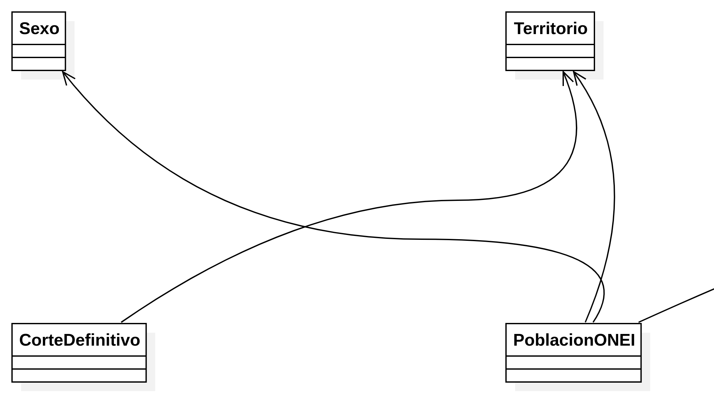

**Figura 2.1a.** Recorte del modelo conceptual `DM-01`: territorio, sexo, corte y población ONEI. Vista completa en el Anexo B.1.

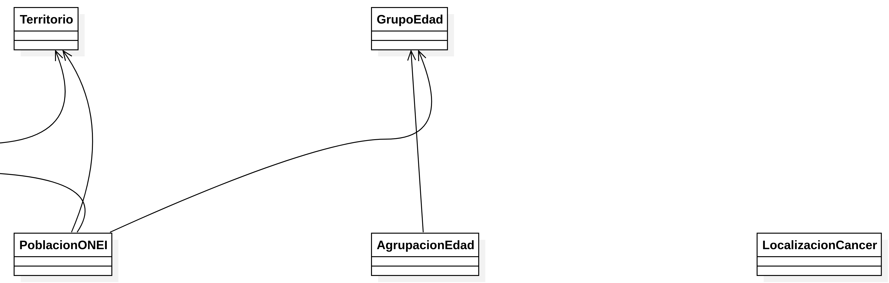

**Figura 2.1b.** Recorte del modelo conceptual `DM-01`: agrupaciones de edad y localización tumoral. Vista completa en el Anexo B.1.

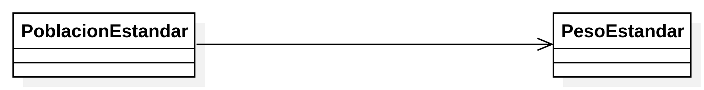

**Figura 2.1c.** Recorte del modelo conceptual `DM-01`: población estándar y pesos. Vista completa en el Anexo B.1.

El caso de uso `CU-01` sitúa la consulta y la exportación en el espacio público. Como la vista contiene solo dos objetivos, se muestra completa para conservar la relación con el actor y las notas sobre filtros, medidas, formatos y cortes definitivos. Véase también la exportación original en el Anexo B.2.

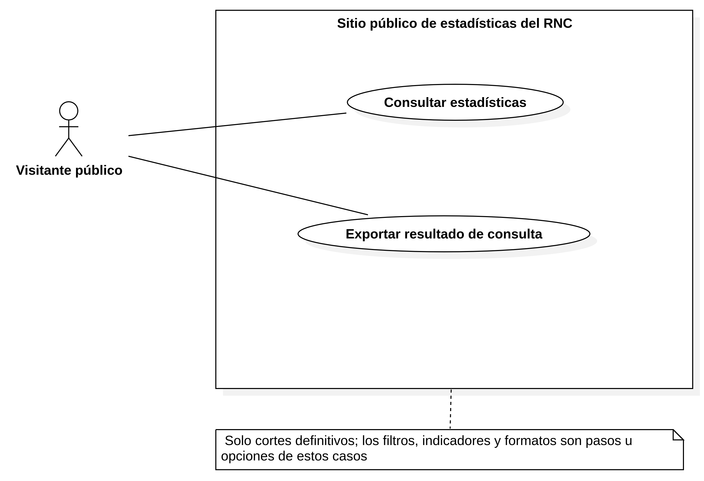

**Figura 2.2.** Caso de uso `CU-01`: consulta pública y exportación. Al ser una vista breve, se muestra completa; la exportación original está en el Anexo B.2.

La actividad `ACT-02` se presenta en dos momentos: selección y validación de filtros; luego disponibilidad de numeradores y denominadores, cálculo y decisión de salida. Los recortes se solapan ligeramente para mantener visible la continuidad. El recorrido completo, incluidas las calles, está en el Anexo B.3.

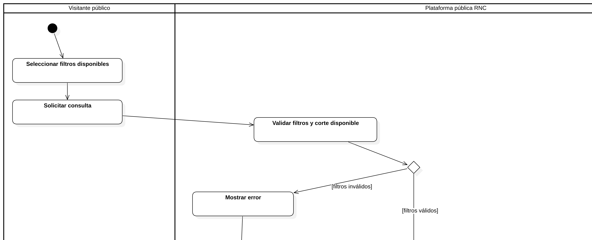

**Figura 2.3a.** Recorte de `ACT-02`: selección y validación inicial de filtros. Vista completa en el Anexo B.3.

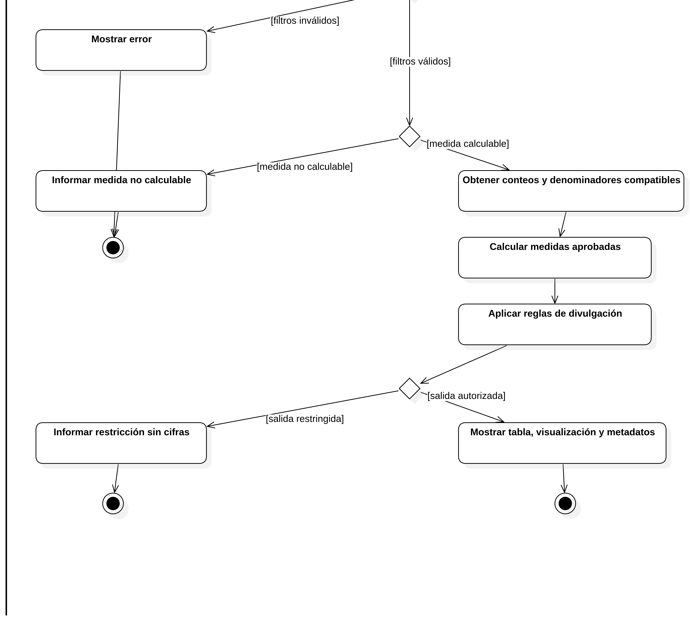

**Figura 2.3b.** Recorte de `ACT-02`: disponibilidad de datos y cálculo de medidas. Vista completa en el Anexo B.3.

El modelo entidad-relación `ER-01` es preliminar. Sus dos recortes destacan las dos poblaciones que el diseño debe mantener separadas: ONEI como fuente de denominadores y la población estándar como origen de pesos. El resto de entidades, relaciones y campos puede consultarse en la vista completa del Anexo B.9; el dibujo no fija el modelo físico ni resuelve el grano del CSV.

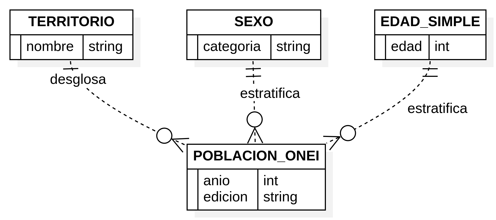

**Figura 2.4a.** Recorte de `ER-01`: dimensiones de territorio, sexo y edad que estratifican la población ONEI. Vista completa en el Anexo B.9.

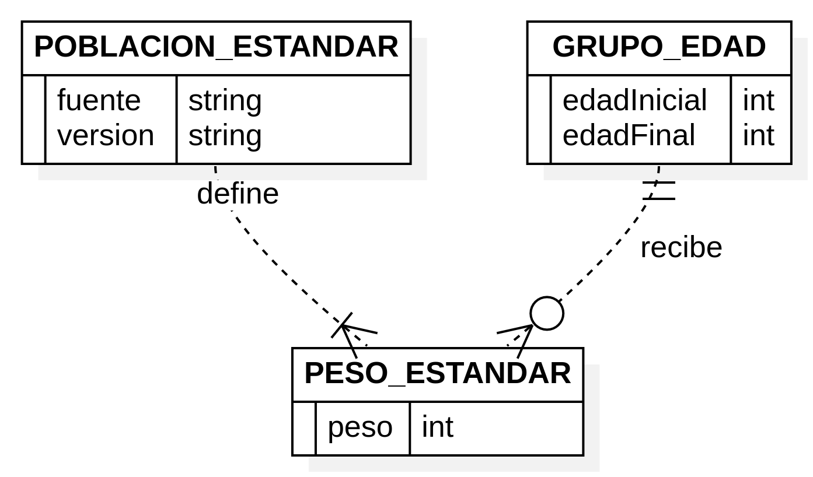

**Figura 2.4b.** Recorte de `ER-01`: relación entre población estándar, grupos de edad y pesos. Vista completa en el Anexo B.9.

La actividad `ACT-01` documenta una propuesta de incorporación técnica. La Figura 2.5a destaca la selección del corte y la comprobación del contrato estructural; la Figura 2.5b enfoca la evaluación de evidencia, la cobertura ONEI y el registro del resultado técnico. El flujo íntegro del Anexo B.11 incluye los caminos de incompatibilidad y revisión. Este proceso no corrige casos clínicos ni decide si un desglose debe publicarse.

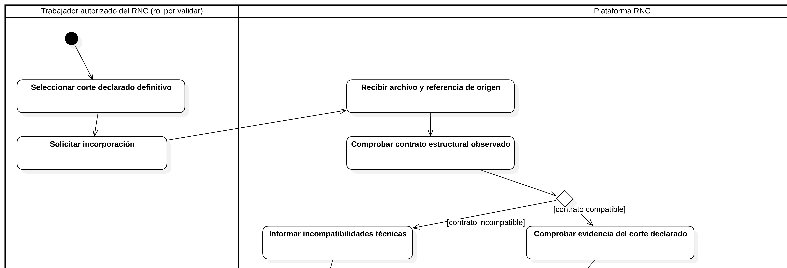

**Figura 2.5a.** Recorte de `ACT-01`: recepción del archivo y comprobación técnica inicial. Vista completa en el Anexo B.11.

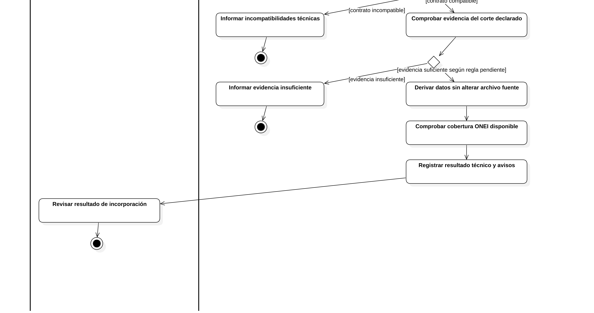

**Figura 2.5b.** Recorte de `ACT-01`: evidencia de definitividad, cobertura poblacional y registro del resultado. Vista completa en el Anexo B.11.

Las demás vistas completan esta propuesta sin repetirse aquí en tamaño reducido: `SD-01` detalla la consulta; `CD-01` las responsabilidades de sus clases; `CMP-01` la organización de componentes; `CD-02`/`SD-03` la estrategia e interacción de exportación; `CU-02`/`ACT-01` el recorrido administrativo; y `CD-03`/`SD-02` las clases e interacción de incorporación. Sus exportaciones completas se identifican en el Anexo B. La coherencia entre cada secuencia, las operaciones de las clases y los requisitos debe revisarse antes de considerar cerrado el diseño.

El [método y especificación de clases](../06-arquitectura/metodo-y-clases-staruml.md) y la [guía de construcción de StarUML](../06-arquitectura/plan-operativo-diagramas-staruml.md) contienen los elementos, relaciones, nombres y comprobaciones de cada figura.

## 2.4. Datos y cálculos

El contrato estructural conocido contiene 84 columnas y conserva su orden entre las entregas previstas [24]. El Manual de Procedimientos separa en el formulario de caso dirección/residencia habitual, localidad, municipio y provincia; define municipio y provincia como datos de residencia, y registra aparte la provincia informante. También incluye incidencia total por municipio de residencia en sus cuadros [3]. Sin embargo, el Manual no asigna los encabezados abreviados del CSV recibido a esos campos ni establece aquí sus códigos municipales. El estudiante recuerda que `LOC` y `LUGAR` podrían ser equivalentes y referirse al municipio, pero esta interpretación no está confirmada: el diccionario debe aclarar su significado, granularidad, códigos y relación con residencia, atención o fuente informante. No se deben fusionar ni contar como dimensiones independientes hasta aclararlo.

En la clasificación tumoral, el Manual distingue topografía (sitio anatómico/subsitio) de morfología (diagnóstico histológico completo) [3]. Para identificar el tipo histológico de un linfoma se necesita la morfología; el formulario registra además Ann Arbor para linfomas, que corresponde a estadio y no sustituye la histología. Por ello, una consulta sobre Hodgkin debe precisar si agrupa por tipo histológico, por estadio o por ambos. La categoría analítica y la correspondencia entre códigos y filtros/publicación deben seguir la clasificación y las agrupaciones que autorice el RNC; la referencia internacional de CIE-O fundamenta la distinción entre ejes, pero no define por sí sola una regla cubana [34].

El Anexo 3.1 del Manual establece requisitos para los paquetes de cierre enviados desde las provincias/unidades al RNC, incluida la exportación desde el sistema automatizado y la prohibición de manipular esas bases con otro software [3]. No se ha demostrado que el CSV de muestra entregado al proyecto sea ese paquete interno ni que comparta su propósito; origen, autorización y tratamiento deben aclararse antes de diseñar el importador. Tampoco se identifican inequívocamente en el CSV el año de incidencia ni un conteo agregado. Siguen pendientes el diccionario autorizado, el grano por fila, tipos, dominios, nulabilidad, relaciones, identificadores de corte y campos requeridos. Solo el nivel territorial autorizado debe pasar a la capa analítica; una dirección exacta no es necesaria para los gráficos previstos. El contraste preliminar de encabezados está en el [esquema recibido](../05-requisitos/esquema-archivo-recibido.md); no se copian valores clínicos ni identificadores al informe. Los datos sintéticos para probar volumen y gráficos se prepararán en una etapa posterior con la misma estructura y sin reutilizar valores reales [24].

El modelo debe distinguir casos/tumores contables, población denominadora ONEI, población estándar, clasificación, territorios, sexo, edades y versión del corte. La clasificación de tumores y la presentación agregada pueden tener niveles y códigos diferentes [3], [5]. No conviene fijar tablas, claves o cardinalidades hasta confirmar si cada fila representa un caso individual o un registro agregado.

**Cuestiones pendientes para cerrar esta sección:** obtener el diccionario autorizado y la semántica del grano; cotejar el método internacional de ajuste con un resultado RNC; acordar el cálculo con edades desconocidas, ceros y grupos nuevos; definir la política de divulgación de agregados y quién la aprobará. Las pruebas de referencia y los datos sintéticos de volumen se prepararán después de conocer esas reglas, manteniendo separados datos reales y sintéticos [16], [22], [24].

## 2.5. Selección tecnológica y prototipos

El Anexo A exige comparar tecnologías de cálculo, visualización, aplicación y almacenamiento [2]. La evaluación considera ajuste al trabajo estadístico, contrato de entrada CSV, simplicidad operativa, accesibilidad, conectividad limitada, licencias y posibilidad de desplegar en la infraestructura disponible. La revisión de documentación primaria vigente se recoge en la matriz técnica de arquitectura [25].

La recomendación inicial es **Python con Django** en un monolito modular, usando HTML/CSS y JavaScript progresivo para no añadir de inicio un frontend SPA separado. Python permite mantener el procesamiento y la aplicación en un mismo entorno; Django aporta formularios, plantillas, estructura y controles web integrados [25]. **Django no impone el aspecto visual:** sus plantillas permiten trabajar libremente la presentación, por lo que es posible crear un sitio muy atractivo y con identidad propia [30], [31]. La calidad visual dependerá de los wireframes, la tipografía, la jerarquía, la paleta, las imágenes, la composición y los detalles de interacción, además de las pruebas en escritorio y móvil.

Para la capa visual se propone comparar CSS propio organizado con tokens y componentes reutilizables, Bootstrap con tema personalizado y Tailwind CSS. Bootstrap aporta una base responsiva mobile-first; Tailwind permite componer estilos y breakpoints propios [32], [33]. No se recomienda dejar un tema predeterminado sin adaptar. La elección se hará en el prototipo atendiendo a identidad visual, accesibilidad, velocidad de diseño y peso servido. FastAPI sería apropiado si se confirma una API independiente; Flask ofrece mayor libertad pero requiere escoger más componentes; Dash/Shiny aceleran prototipos estadísticos, aunque deben probar su adecuación a un portal público ligero y accesible. Java/Spring, ASP.NET Core, Laravel y Node.js permanecen como alternativas si la experiencia del equipo o la infraestructura institucional los favorecen. Esta comparación es una inferencia técnica del alcance, no una aprobación del RNC.

Para la entrada se propone validar estructura con el módulo estándar `csv` y usar `pandas` para exploración tabular después de recibir el diccionario y confirmar el grano de cada fila [26]. El volumen estimado de miles de filas no justifica por sí solo herramientas de procesamiento distribuido ni adoptar Polars. Los cálculos epidemiológicos se mantendrían en módulos explícitos, versionados y contrastados con ejemplos aprobados; el método y los intervalos siguen pendientes de validación.

Para gráficos, **Apache ECharts** es la primera candidata por la posibilidad de construir un paquete con los componentes usados y por sus recursos ARIA; **Plotly.js** se mantiene como alternativa directa de comparación [27], [28]. La elección se cerrará en prototipos con mediciones de recursos servidos localmente, claridad, navegación por teclado, lector de pantalla y funcionamiento con conexión limitada. Toda salida gráfica tendrá una tabla equivalente y metadatos; la gráfica no será el único canal de información.

Para persistencia, **PostgreSQL** es el candidato productivo inicial por su modelo relacional, restricciones, transacciones y licencia permisiva [29]. SQLite puede facilitar el desarrollo local, pero no se fija como almacén institucional multiusuario. La base definitiva depende de que el RNC/CUJAE confirme los motores, respaldos, permisos y servicios que puede operar. CSV se conserva como formato de transporte, no como almacén de la plataforma.

La recomendación por capa queda resumida así:

- **Aplicación e interfaz:** Python/Django con HTML semántico y JavaScript progresivo. FastAPI, Flask, Dash/Shiny, Java/Spring, ASP.NET Core, Laravel y Node.js se mantienen como alternativas si hay necesidad de API, experiencia previa o infraestructura que las favorezca.
- **Visualización:** evaluar Apache ECharts frente a Plotly.js; D3 o Chart.js quedan como opciones para prototipos concretos. La decisión depende del peso descargado y la accesibilidad observada.
- **Entrada y análisis:** módulo `csv` para comprobar la estructura; pandas para exploración tabular tras recibir diccionario y grano. XLSX, Polars o R se incorporarán si los formatos, mediciones o experiencia lo justifican.
- **Persistencia:** PostgreSQL es candidato de producción; SQLite sirve para el desarrollo local. DuckDB puede ayudar en análisis local, y el motor relacional institucional puede reemplazar la propuesta.
- **Exportación:** CSV con biblioteca estándar; elegir componentes XLSX y PDF tras validar metadatos, presentación y divulgación.

**Selección para prototipos:** Python/Django, HTML progresivo, validación CSV independiente, pandas para exploración, prototipo ECharts/Plotly y SQLite local si facilita el desarrollo. **Candidato de producción:** PostgreSQL, sujeto a validación institucional. La revisión no cierra versiones concretas ni implementa todavía reglas estadísticas pendientes. Para completar la decisión se requiere confirmar infraestructura, probar los dos gráficos con datos sintéticos de miles de filas, evaluar accesibilidad/conectividad, obtener el diccionario semántico y validar los cálculos con resultados RNC aprobados.

Los prototipos deben cubrir dos recorridos. En el público: elegir filtros; distinguir grupos clásicos de agrupaciones nuevas; revisar frecuencia/tasa, población, periodo y método; entender ausencia o restricción de una salida; y exportar. En el prototipo administrativo: seleccionar archivo, examinar metadatos, recibir errores técnicos y ver cortes incorporados, sin atribuir corrección clínica ni roles no confirmados. La evaluación propuesta utilizará tareas observables y registrará finalización, errores, solicitudes de ayuda, comprensión del resultado y facilidad de exportación; WCAG y rendimiento se comprobarán por separado [11]–[13]. No se fijan metas numéricas hasta acordar perfiles, tareas, dispositivos e infraestructura. **Pendiente:** completar prototipos, participantes autorizados, instrumento, sesiones, hallazgos y cambios derivados.

## Conclusiones parciales del capítulo 2

La propuesta de solución cuenta ahora con trece vistas gráficas preliminares: dominio, casos de uso, actividades, interacciones, clases, componentes y datos. Estas vistas hacen explícitos los principales flujos de consulta, incorporación y exportación, y sirven como base revisable para completar el diseño. Aún no demuestran que los requisitos hayan sido aceptados, que las reglas estadísticas estén cerradas ni que el software haya sido implementado. Antes de considerar el diseño validado se deben revisar coherencia entre diagramas, claridad gráfica, correspondencia con requisitos y las decisiones pendientes de datos, métodos y publicación.

# Capítulo 3. Implementación y validación

## Introducción del capítulo

Este capítulo se completará con los componentes que realmente se implementen durante Prácticas II y con evidencia de pruebas. La guía académica [15] exige describir objetivos de validación, escenarios, entradas, salidas esperadas y obtenidas, herramientas y parámetros pertinentes.

## 3.1. Componentes implementados

**PENDIENTE:** estructura del software, contratos de entrada, motor de tasas/intervalos, consulta, frecuencias y exportación; versión del código y decisiones aplicadas. Distinguir funciones terminadas, prototipos y trabajo posterior.

## 3.2. Diseño de pruebas

Preparar casos reproducibles para: tasas crudas y específicas; ajuste directo e indirecto; intervalos; edades 0–4, 85+ y agrupaciones nuevas; denominador cero o ausente; clasificación y filtros; rechazo de archivo incompatible o sin estado definitivo acreditado; exportación coherente con la pantalla; datos sin resultado publicable. Cada caso debe contener entrada, regla/fórmula aplicada, resultado esperado por fuente aprobada, resultado obtenido y veredicto. No presentar como aprobada ninguna cifra calculada únicamente con reglas externas.

## 3.3. Resultados de validación

**PENDIENTE DE EJECUCIÓN:** tabla de pruebas y defectos corregidos; evaluación de prototipos con tareas reales; condiciones de dispositivo y conectividad; límites de la prueba. No usar tiempos, porcentajes o capturas ficticios.

## Conclusiones parciales del capítulo 3

**PENDIENTE DE RESULTADOS.** Explicar qué objetivos de prueba se alcanzaron, cuáles no, y qué limitaciones concretas conserva la versión entregada.

# Conclusiones generales

**PENDIENTE DE RESULTADOS.** Al final, derivar al menos una conclusión técnica por cada objetivo específico cumplido. No reemplazar conclusiones por una lista de tareas realizadas [15].

# Recomendaciones

**PENDIENTE DE RESULTADOS.** Formular solo continuaciones sustentadas por limitaciones observadas, por ejemplo validar reglas pendientes, ampliar cobertura o completar el panel seguro de la etapa posterior.

# Referencias de trabajo

El formato se normalizará con la tutora. Las fuentes se revisaron hasta el 13-10-2026; el [catálogo maestro](../../sources/catalogo.md) contiene fecha de consulta, ID y estado de cada una.

[1] Registro Nacional de Cáncer de Cuba y Facultad de Ingeniería Informática, CUJAE. *Propuesta de Trabajo: Plataforma web interactiva para la visualización del Registro Nacional de Cáncer de Cuba*. Documento del proyecto, 2026.  
[2] *Anexo A. Plan individual de tareas del estudiante Danny Fiallo Muñoz*. Documento del proyecto, 2026.  
[3] Ministerio de Salud Pública de Cuba. *Manual de procedimientos del Registro Nacional de Cáncer de Cuba*, versión VII. La Habana: Editorial Ciencias Médicas, 2024.  
[4] Y. Iglesias Ventura. Comunicación escrita al equipo del proyecto sobre grupos etarios y población ONEI, 30-09-2026. Registro de la comunicación: `../08-reuniones/01-aclaracion-yinet-2026-09-30.md`.  
[5] Ministerio de Salud Pública de Cuba. *Anuario Estadístico de Salud 2024*, edición 2025. https://files.sld.cu/dne/files/2025/09/AES-2024-para-sitio-3.pdf  
[6] National Cancer Institute. *SEER*Explorer: Overview*. Actualización consultada de 2026. https://seer.cancer.gov/statistics-network/explorer/overview.html  
[7] International Agency for Research on Cancer. *Global Cancer Observatory: Cancer Today*, versión GLOBOCAN 2024, 08-07-2026. https://gco.iarc.who.int/today/en/  
[8] European Commission, Joint Research Centre. *European Cancer Information System: Data Explorer*. https://ecis.jrc.ec.europa.eu/data-explorer  
[9] Centers for Disease Control and Prevention. *United States Cancer Statistics: Data Visualizations and Technical Notes*. https://www.cdc.gov/united-states-cancer-statistics/dataviz/index.html  
[10] F. Bray y otros, eds. *Cancer Incidence in Five Continents*, vol. XII, IARC Scientific Publication 169. IARC/IACR, 2024. https://publications.iarc.who.int/Book-And-Report-Series/Iarc-Scientific-Publications/Cancer-Incidence-In-Five-Continents-Volume-XII-2024  
[11] World Wide Web Consortium. *Web Content Accessibility Guidelines (WCAG) 2.2*. https://www.w3.org/TR/WCAG22/  
[12] *Design, Application, and Actionability of US Public Health Data Dashboards: Scoping Review*. *Journal of Medical Internet Research*, 2025. https://www.jmir.org/2025/1/e65283/  
[13] I. Yanovitzky, G. Stahlman y M. Kim. «Usability and usefulness of U. S. federal and state public health data dashboards: implications for improving data access and use». *Frontiers in Public Health*, vol. 13, 2025, doi:10.3389/fpubh.2025.1699312. https://www.frontiersin.org/journals/public-health/articles/10.3389/fpubh.2025.1699312/full  
[14] *CaRDO: A Tool for Empowering Cancer Registries to Publish Population-Level Cancer Statistics Online*. Publicación científica, 2025. https://pmc.ncbi.nlm.nih.gov/articles/PMC13151749/  
[15] M. André Ampuero. *Buenas prácticas para escribir y defender un trabajo de diploma de Ingeniería Informática*. Facultad de Ingeniería Informática, CUJAE, 2026.  
[16] *Línea base de requisitos y entregables — Prácticas II*. Documento de trabajo del proyecto, 2026. `../05-requisitos/linea-base-practicas-ii.md`.
[17] D. Fiallo Muñoz. Aclaraciones de la dirección de producto sobre acceso público, publicación, entrada de archivos y conectividad, 30-09-2026. Registradas como `SRC-RNC-004` en el [catálogo](../../sources/catalogo.md).
[18] D. Fiallo Muñoz. Aclaraciones sobre población estándar, datos definitivos, sistema interno, confidencialidad y usuarios, 06-10-2026. Registradas como `SRC-RNC-006` en el [catálogo](../../sources/catalogo.md).
[19] Oficina Nacional de Estadística e Información. *Anuario Demográfico de Cuba 2024*, 2025. https://www.onei.gob.cu/sites/default/files/publicaciones/2025-07/00-anuario-demografico-2024.pdf
[20] Ministerio de Justicia de Cuba. *Gaceta Oficial ordinaria núm. 90 de 2022*: Ley 149/2022 de Protección de Datos Personales y Resolución 58/2022. https://www.minjus.gob.cu/sites/default/files/archivos/publicacion/2022-08/goc-2022-o90_0_0.pdf
[21] D. Fiallo Muñoz. Aclaración posterior sobre normas internacionales de cáncer y denominadores poblacionales cubanos, 06-10-2026. Registrada como `SRC-RNC-007` en el [catálogo](../../sources/catalogo.md).
[22] International Agency for Research on Cancer / International Association of Cancer Registries. *Cancer Incidence in Five Continents*: ayuda metodológica y tabla de población estándar mundial Segi/Doll. https://ci5.iarc.who.int/ci5-xii/about/
[23] A. Cockburn. *Hexagonal Architecture: Ports and Adapters*, 2005. https://alistair.cockburn.us/hexagonal-architecture
[24] D. Fiallo Muñoz. Confirmación de la estabilidad de la estructura del CSV entregado, 12-10-2026. Esquema observado y cuestiones semánticas pendientes: `../05-requisitos/esquema-archivo-recibido.md`.
[25] D. Fiallo Muñoz. *Comparación y selección tecnológica inicial para la plataforma del RNC*. Documento de trabajo de Prácticas II, corte 13-10-2026. `../06-arquitectura/seleccion-tecnologica.md`.
[26] Python Software Foundation. *csv — CSV File Reading and Writing*; pandas development team. *pandas.read_csv*. https://docs.python.org/3/library/csv.html ; https://pandas.pydata.org/docs/reference/api/pandas.read_csv.html
[27] Apache Software Foundation. *Apache ECharts: Download, license and web accessibility*. https://echarts.apache.org/en/download.html ; https://echarts.apache.org/handbook/en/best-practices/aria/
[28] Plotly. *Plotly.js is free and open-source software; license MIT*. https://plotly.com/javascript/is-plotly-free/
[29] PostgreSQL Global Development Group. *PostgreSQL License and Feature Matrix*. https://www.postgresql.org/about/licence/ ; https://www.postgresql.org/about/featurematrix/
[30] Django Software Foundation. *Django documentation, overview and supported versions*. https://docs.djangoproject.com/en/6.1/intro/overview/ ; https://www.djangoproject.com/download/
[31] Django Software Foundation. *The Django template language and templates*. https://docs.djangoproject.com/en/6.0/ref/templates/
[32] The Bootstrap Authors. *Bootstrap: approach to responsive, mobile-first components*. https://getbootstrap.com/docs/5.3/extend/approach/
[33] Tailwind Labs. *Tailwind CSS: theme variables and responsive design*. https://tailwindcss.com/docs/theme ; https://tailwindcss.com/docs/responsive-design
[34] World Health Organization. *International Classification of Diseases for Oncology, 3rd Edition (ICD-O-3)*. Clasificación para registros de cáncer con ejes de topografía y morfología. https://www.who.int/standards/classifications/other-classifications/international-classification-of-diseases-for-oncology

# Anexos

## Anexo A. Trazabilidad y materiales pendientes

La matriz maestra de fuentes, evidencias, requisitos y preguntas se mantiene en `rnc-research/docs/evidence-map.md`, el catálogo de fuentes y la línea base de requisitos [16]. Se incorporará aquí una tabla de trazabilidad consolidada cuando los IDs y criterios se validen con tutoría y el RNC.

## Anexo B. Exportaciones completas de StarUML

Las siguientes imágenes proceden de la exportación PNG actual del modelo StarUML, fechada el 13 de octubre de 2026. Se incluyen completas y sin los recortes usados en el capítulo 2 para poder consultar el flujo y las relaciones en contexto. Los archivos fuente de imagen se conservan en alta resolución dentro de `figuras/`; en formato digital se pueden ampliar para leer las etiquetas.

### Figura B.1. DM-01. Conceptos del dominio RNC y ONEI

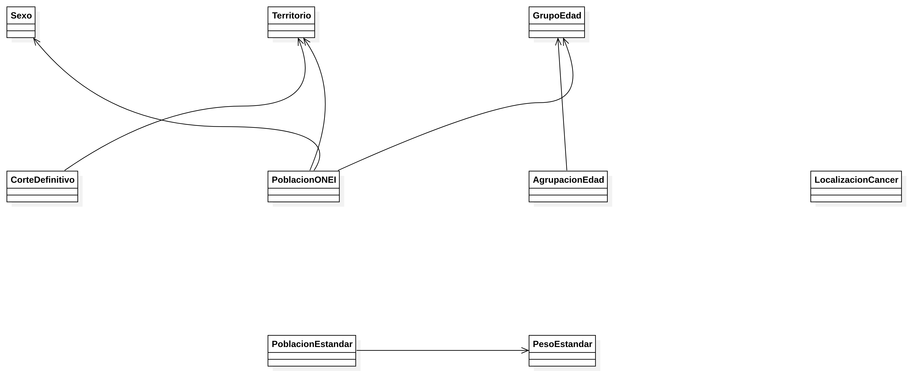


### Figura B.2. CU-01. Consulta pública de estadísticas


### Figura B.3. ACT-02. Consulta y presentación de estadísticas

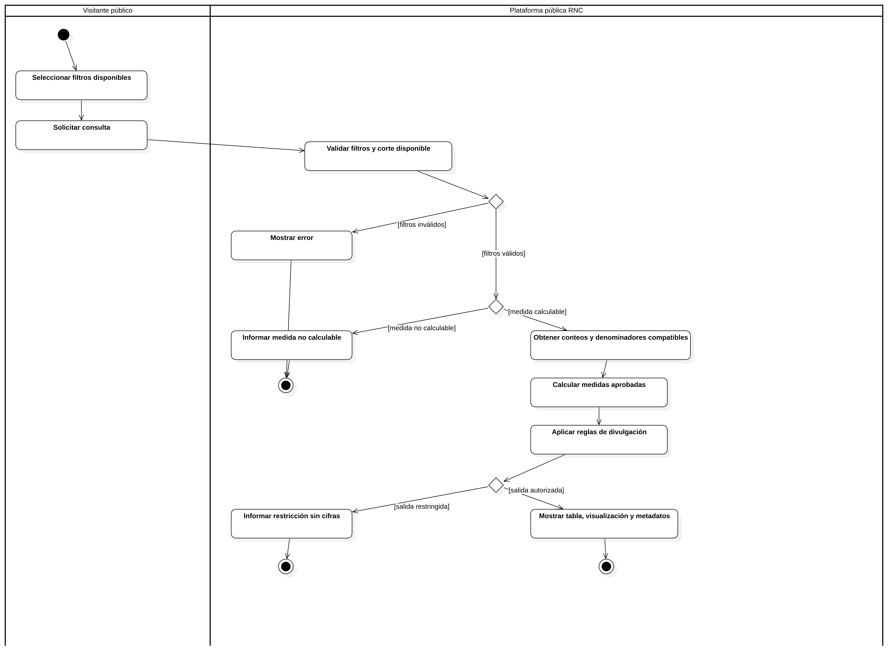


### Figura B.4. SD-01. Consultar estadísticas


### Figura B.5. CD-01. Diseño lógico de consulta pública

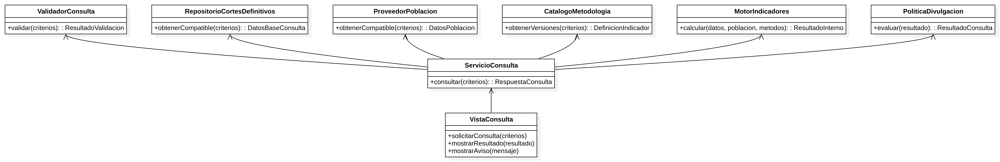


### Figura B.6. CMP-01. Componentes lógicos de la plataforma

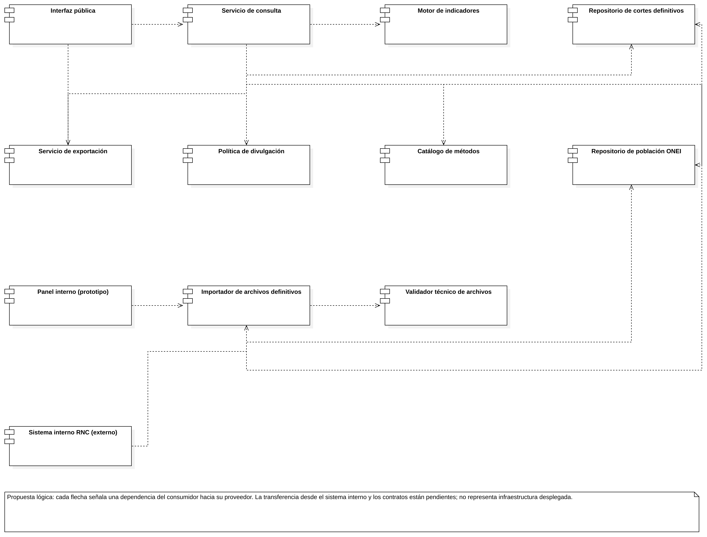


### Figura B.7. CD-02. Diseño de exportación

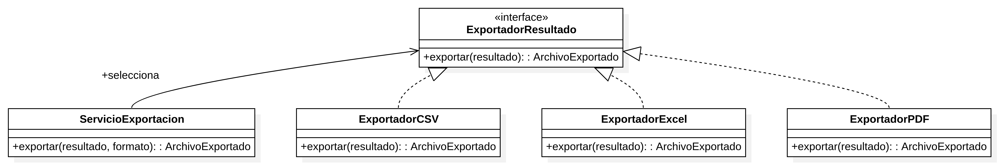


### Figura B.8. SD-03. Exportar resultado autorizado

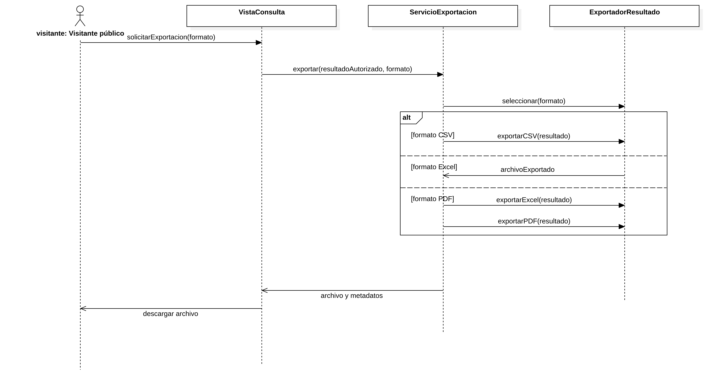


### Figura B.9. ER-01. Modelo lógico de datos preliminar

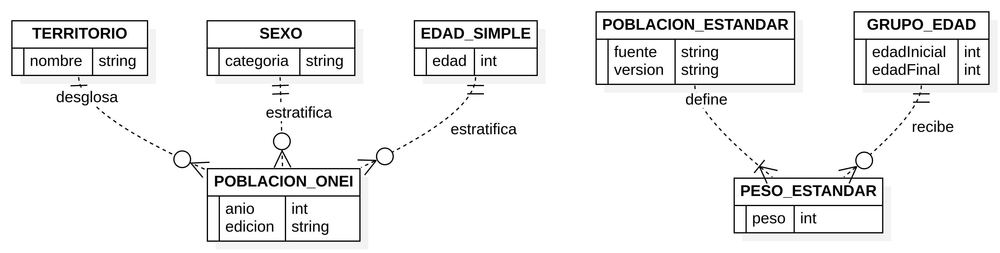


### Figura B.10. CU-02. Incorporación técnica de archivos

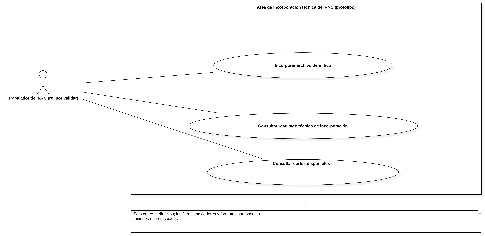


### Figura B.11. ACT-01. Incorporación de archivo definitivo

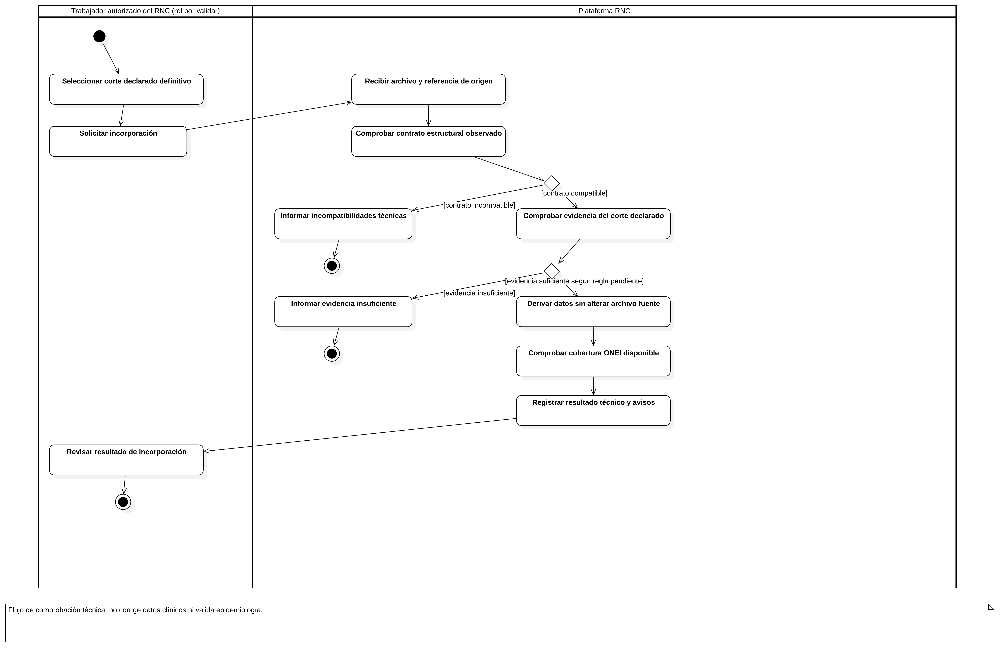


### Figura B.12. CD-03. Diseño lógico de incorporación

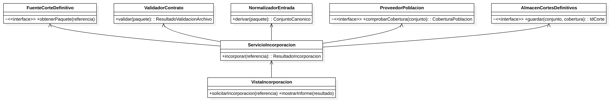


### Figura B.13. SD-02. Incorporar corte definitivo


## Anexo C. Diccionario de datos y ejemplos autorizados

Pendiente de recibir y validar con el RNC. No incluir valores de la muestra sensible en este documento.

## Anexo D. Casos y resultados de verificación

Se completará después de implementar las capacidades y obtener valores de referencia aprobados.

## Anexo E. Evaluación de prototipos

Se completará cuando se acuerden perfiles, tareas, participantes autorizados e instrumento de evaluación.
