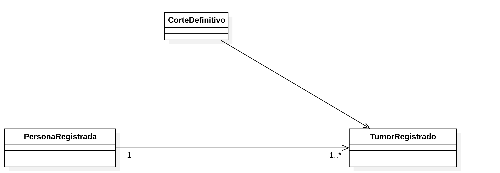

# Plataforma web interactiva para consultar estadísticas del Registro Nacional de Cáncer de Cuba

**Borrador de informe de Prácticas II y base del trabajo de diploma**  
Autor: Danny Fiallo Muñoz  
Facultad de Ingeniería Informática, Universidad Tecnológica de La Habana «José Antonio Echeverría»  
Corte documental: 20 de octubre de 2026
Estado: borrador de trabajo; revisar título, tutoría, problema, objetivos y estructura con los tutores antes de entregar.

> Este es el texto maestro editable. Los pasajes marcados **PENDIENTE** requieren resultados propios, datos del RNC o una decisión de tutoría. Las referencias entre corchetes siguen una numeración provisional uniforme; antes de la entrega se normalizarán todos los metadatos en el estilo acordado. El material de `rnc-research` permite fundamentar el documento, pero no reemplaza la validación de métodos ni los resultados del software.

## Resumen y Abstract

**Resumen.** El Registro Nacional de Cáncer (RNC) de Cuba difunde resultados epidemiológicos principalmente mediante publicaciones estáticas, lo que limita la exploración de combinaciones de filtros. Este trabajo estudia una plataforma web pública para consultar estadísticas de incidencia y propone requisitos, arquitectura y prototipos dentro del alcance de Prácticas II. Se revisaron el Manual de Procedimientos del RNC, documentos del proyecto, métodos estadísticos y sistemas comparables; las reglas cubanas pendientes se mantuvieron diferenciadas de las propuestas. Se implementó localmente un prototipo Django con datos exclusivamente sintéticos: validación técnica de archivos de demostración, administración de cortes, consulta de agregados, gráficos y exportaciones. La publicación genera un paquete agregado versionado y separa las rutas administrativas de las públicas. La suite local de 58 pruebas pasó, incluida una prueba de carga, publicación, consulta con configuración pública y revocación. La revisión de interfaz del 20 de octubre aprobó 1333 comprobaciones de navegador en tres tamaños de pantalla. Estas evidencias comprueban comportamiento técnico con datos sintéticos; no validan cálculos con resultados aprobados por el RNC, políticas de divulgación, seguridad productiva ni usabilidad con participantes. Se concluye que existe una base funcional para continuar la evaluación, condicionada a obtener el diccionario autorizado, contrastar los métodos y acordar controles de publicación con el RNC y los tutores.

**Palabras clave:** registro de cáncer; estadísticas de incidencia; visualización web; datos agregados; prototipo.

**Abstract.** The Cuban National Cancer Registry (RNC) mainly disseminates epidemiological results through static publications, which limits the exploration of combined filters. This work examines a public web platform for querying cancer incidence statistics and proposes requirements, an architecture, and prototypes within the scope of the second practicum. The RNC Procedures Manual, project documents, statistical methods, and comparable systems were reviewed; unresolved Cuban rules were kept distinct from design proposals. A local Django prototype was implemented using synthetic data only. It includes technical validation of demonstration files, release administration, aggregate queries, charts, and exports. Publishing creates a versioned aggregate package and separates administrative routes from public routes. The local suite of 57 tests passed, including a synthetic upload, publication, public-profile query, and revocation scenario. The interface review recorded 1,333 browser checks at three viewport sizes. These results verify technical behavior with synthetic data; they do not validate calculations against RNC-approved results, disclosure policy, production security, or usability with participants. The prototype provides a basis for continued evaluation, subject to obtaining the authorized data dictionary, checking methods against approved references, and agreeing on publication controls with the RNC and academic supervisors.

**Keywords:** cancer registry; incidence statistics; web visualization; aggregate data; prototype.

## Introducción

El Registro Nacional de Cáncer (RNC) de Cuba es un registro poblacional de alcance nacional que reúne información sobre tumores diagnosticados en residentes permanentes. Su manual de procedimientos describe una red de unidades informantes, estructuras territoriales y una oficina central que revisa, valida, consolida y analiza los datos [3]. Las estadísticas resultantes apoyan el conocimiento epidemiológico del cáncer, la planificación sanitaria y la investigación [1], [3].

La Propuesta de Trabajo del proyecto identifica una limitación en la forma de difusión: los resultados disponibles se consultan principalmente mediante documentos PDF, lo que dificulta combinar dinámicamente año, territorio, sexo, edad y localización tumoral para responder preguntas específicas [1]. El Anuario Estadístico de Salud 2024 muestra que Cuba ya publica conteos y tasas de incidencia, incluidas tasas ajustadas por edad, pero las cifras de incidencia de 2022 allí recogidas están marcadas como preliminares [5]. La futura plataforma pública, según la dirección actual del proyecto, consultará exclusivamente cortes identificados como definitivos [17].

La necesidad de consulta dinámica tiene antecedentes internacionales, aunque esos sistemas responden a poblaciones y métodos propios. SEER*Explorer permite obtener gráficos, tablas y descargas a partir de dimensiones estadísticas [6]; Cancer Today facilita comparaciones internacionales mediante distintas visualizaciones [7]; ECIS distingue series históricas observadas de estimaciones y proyecciones [8]. Estos ejemplos orientan el diseño, pero sus poblaciones estándar, clasificaciones, reglas de publicación y métodos de cálculo no se trasladan automáticamente al RNC cubano.

**Situación problemática documentada.** Existe información epidemiológica oficial, pero la vía de publicación descrita en la propuesta limita la exploración interactiva y la obtención de resultados según combinaciones de variables de interés [1]. Para desarrollar una alternativa confiable hay que preservar la definición cubana de caso, la correspondencia entre casos y población, la confidencialidad de los registros individuales y la trazabilidad de los cortes publicados [3], [17], [18]. Ya se dispone de una muestra que permite documentar la estructura estable del CSV; aún faltan los cortes definitivos autorizados para el desarrollo, el diccionario semántico, las series ONEI detalladas y ejemplos oficiales de cálculo con que comprobar la aplicación de la estándar mundial.

**Problema de investigación propuesto; validar con tutores.** ¿Cómo facilitar la consulta pública e interactiva de estadísticas definitivas del RNC de Cuba y el cálculo reproducible de indicadores de incidencia a partir de datos y reglas aprobados por el registro?

**Objeto de estudio propuesto; validar con tutores.** La difusión y el análisis de estadísticas de registros poblacionales de cáncer mediante sistemas informáticos.

**Campo de acción propuesto; validar con tutores.** El diseño de una plataforma web para consultar y calcular estadísticas agregadas de incidencia del RNC de Cuba.

**Objetivo general del proyecto.** Desarrollar una plataforma web interactiva para consultar estadísticas de incidencia del RNC y calcular tasas crudas, específicas y ajustadas, de acuerdo con los datos y métodos aprobados [1], [2]. El verbo y el alcance exactos del objetivo académico deben acordarse con los tutores.

**Objetivos específicos de trabajo, propuestos para el informe:**

1. Caracterizar el proceso estadístico del RNC, los indicadores necesarios y las soluciones comparables.
2. Definir los requisitos y el diseño de la plataforma a partir de las fuentes cubanas y la validación con especialistas.
3. Desarrollar el núcleo de consulta, cálculo y exportación previsto para Prácticas II.
4. Evaluar la corrección de los cálculos y la adecuación de las funciones implementadas mediante casos verificables.

**Tareas del trabajo, organizadas para hacer verificables los objetivos y sujetas al calendario del Anexo A [2]:**

| Objetivo | Tareas asociadas | Evidencia que se documentará |
|---|---|---|
| 1 | 1.1 Analizar el proceso del RNC, sus publicaciones y conceptos epidemiológicos. 1.2 Comparar plataformas y estudios pertinentes, identificando aportes y límites. | Capítulo 1: síntesis del Manual, definiciones, análisis crítico del benchmark y preguntas abiertas. |
| 2 | 2.1 Precisar requisitos funcionales y de calidad a partir de fuentes y reuniones. 2.2 Elaborar el modelo conceptual y las vistas de diseño. 2.3 Comparar tecnologías y construir prototipos de consulta y administración. | Capítulo 2: matriz trazable de requisitos, diagramas, prototipos, comparación y decisiones justificadas. |
| 3 | 3.1 Implementar las capacidades previstas de cálculo, consulta, frecuencias y exportación, de acuerdo con reglas y datos disponibles. | Capítulo 3: descripción de componentes y versión realmente desarrollada. |
| 4 | 4.1 Diseñar y ejecutar casos de verificación con resultados de referencia aprobados. 4.2 Evaluar las tareas de los prototipos según perfiles y criterios acordados. | Capítulo 3: escenarios, parámetros, resultados observados, incidencias y límites de la evaluación. |

La tabla organiza el plan documental; no declara que las tareas estén concluidas. La implementación segura del panel, la migración histórica y las pruebas integrales de seguridad, rendimiento y usabilidad pertenecen a etapas posteriores según el Anexo. El prototipo administrativo sí forma parte del diseño de Prácticas II.

**Valor práctico esperado.** Una consulta pública que presente estadísticas definitivas con filtros, contexto metodológico y opciones de exportación puede reducir el trabajo manual necesario para explorar las tablas actuales. Es un valor esperado del proyecto; su magnitud solo podrá afirmarse después de evaluar el producto con usuarios y datos reales.

El informe se organiza en tres capítulos. El primero expone fundamentos del registro, indicadores, publicaciones y referentes de diseño. El segundo describe requisitos y la solución propuesta. El tercero presenta los componentes implementados y la verificación técnica realizada hasta el corte documental. La estructura puede ajustarse con los tutores conforme a la guía académica [15].

# Capítulo 1. Fundamentos y antecedentes

## Introducción del capítulo

Se presentan los conceptos y fuentes necesarios para diseñar la plataforma: el proceso del RNC, las medidas de incidencia, la naturaleza de los datos publicados, las experiencias de otros sistemas y los criterios de usabilidad y accesibilidad. La revisión delimita qué afirmaciones son reglas documentadas de Cuba y cuáles son patrones externos por evaluar.

## 1.1. El registro poblacional y el proceso cubano

El Manual de Procedimientos del RNC, versión VII de 2024, describe un registro poblacional que integra reportes de distintas fuentes sanitarias y territoriales. Las unidades informantes notifican tumores; los niveles territoriales revisan y completan la información; y la oficina central realiza controles, consolida los registros y prepara estadísticas. El proceso documentado incluye codificación, evaluación de completitud y consistencia, búsqueda de duplicados y múltiples primarios, pareamiento con mortalidad y cierres periódicos [3]. Esta descripción se toma como evidencia de la versión VII; el RNC debe confirmar si continúa vigente para el trabajo.

Esta cadena establece una frontera importante para el proyecto. La plataforma propuesta es una capa de consulta y difusión de estadísticas provenientes de cortes que el sistema interno ya entrega como definitivos. No sustituye el registro, la investigación de casos, la codificación clínica ni la deduplicación. El Anexo A contempla un prototipo de incorporación técnica, mientras que la aclaración del proyecto indica que el portal no debe corregir los casos ni cambiar su estado epidemiológico [2], [18].

La unidad epidemiológica debe declararse en cada resultado. El Manual establece un reporte por cada tumor primario registrable y describe reglas para tumores múltiples [3]. En una aclaración del 15 de octubre, el estudiante comunicó que cada fila del archivo representa un tumor de una persona y que los identificadores permiten reconocer a quienes tienen varios tumores y contar personas sin duplicarlos [35]. Esta aclaración responde el grano comunicado, pero no reemplaza el diccionario autorizado ni identifica qué columna constituye la clave de persona. El diseño debe distinguir conteos de tumores y de personas, registrar cuál produjo la cifra y mantener los identificadores fuera de la interfaz pública. La estructura estable de 84 columnas permite validar el formato; autorización, semántica y contrato siguen pendientes [24], [35].

Para los denominadores, se requiere población oficial de ONEI con desglose compatible de año, territorio, sexo y edad. El Manual define población residente media como semisuma de la población al inicio y al final del año; ONEI distingue población media de efectiva [3], [19]. ONEI informa que la población efectiva se calcula anualmente por ecuación compensadora, por lo que no equivale a realizar un censo cada uno o dos años. El Anuario Demográfico 2024 ofrece cuadros resumidos y declara que hay tabulaciones y bases adicionales disponibles para quienes las requieran; la matriz exacta por municipio y edad simple no se localizó como descarga abierta. ONEI anunció además sus indicadores demográficos de 2025 [36]. Por tanto, la fuente y el método anual están confirmados, pero siguen por identificar la tabla/edición, el canal de acceso a la desagregación requerida y si cada tasa utilizará población media o efectiva [19], [35], [36].

Las clasificaciones también cumplen funciones diferentes. El Manual indica el uso de CIE-O-3 para topografía y morfología de personas de 20 años o más diagnosticadas desde 2007 y de ICCC-3 para menores de 20 años; las tablas generales del Anuario presentan categorías CIE-10 y las infantiles ICCC-3 [3], [5]. Una interfaz debe declarar qué clasificación y versión sustentan cada filtro o salida. La correspondencia entre códigos de registro y categorías de publicación debe seguir las reglas que confirme el RNC.

La confidencialidad se aplica tanto a los registros fuente como a las salidas. El Manual limita la custodia y comunicación de información nominal; la normativa cubana consultada establece principios de protección de datos personales [3], [20]. La documentación disponible no determina un umbral de supresión para consultas públicas. Por eso, cualquier regla de celdas pequeñas, combinaciones de filtros y exportaciones se considera una decisión institucional pendiente, no un valor que pueda copiarse de un referente extranjero.

## 1.2. Medidas de incidencia y comparabilidad

El Anexo A incluye tasas crudas, específicas por edad, ajustadas por métodos directo e indirecto e intervalos de confianza [2]. Antes de implementarlas, el informe distingue tres denominadores que suelen confundirse: el total de casos que sirve de base a una frecuencia relativa, la población residente usada en una tasa y la población estándar cuyos pesos se usan para el ajuste.

La **frecuencia absoluta** cuenta la unidad declarada en una selección. La **frecuencia relativa** expresa una parte respecto de un universo definido y no es una tasa poblacional. El Manual RNC incluye la emisión de frecuencias absolutas y relativas entre sus objetivos [3]. Un artículo basado en datos del RNC ilustra universos distintos: presenta la proporción de tumores digestivos sobre el total de cánceres y una distribución de etapa por sitio que conserva la categoría sin etapa [37]. Esto prueba el uso y publicación de porcentajes, pero no especifica una regla común para todas las tablas. El denominador, el tratamiento de desconocidos y el redondeo deben acompañar cada indicador; los conteos por tumor y por persona deben rotularse por separado [35], [37]. La tabla citada contiene una nota de exclusión de códigos que debe aclararse antes de usarla como patrón exacto de cálculo.

La **tasa cruda** relaciona el total de casos nuevos con la población correspondiente al mismo periodo y se expresa aquí como tasa anual por 100 000 habitantes:

```text
Tasa cruda = (casos nuevos del periodo / población correspondiente) × 100 000
```

La **tasa específica** aplica la relación dentro de un estrato compatible, por ejemplo, sexo, territorio y grupo de edad:

```text
Tasa específicaᵢ = (casos nuevosᵢ / poblaciónᵢ) × 100 000
```

Estas expresiones son definiciones generales para orientar el análisis. La fecha que determina el año de incidencia, la elección entre población media o efectiva, el manejo de estratos sin denominador y el redondeo aún requieren una especificación reproducible y un ejemplo aceptado por el RNC [3]–[5], [19].

La **estandarización directa por edad** resume tasas específicas aplicándolas a una distribución estándar. Manual RNC y Anuario cubano se refieren a la población estándar mundial [3], [5]. La aclaración del estudiante precisa que la población residente cubana/ONEI proporciona los denominadores y que para cáncer se seguirá la metodología internacional [21]. IARC/CI5 XII documenta la población Segi modificada por Doll, con 18 grupos quinquenales desde 0–4 hasta 85+ y pesos que suman 100 000 [10], [22]. La expresión reproducible es:

```text
ASR = Σ (peso estándarᵢ × casosᵢ / poblaciónᵢ)
```

cuando se usan los pesos absolutos de Segi–Doll y tasas específicas expresadas como casos por persona-año. Equivalentemente, se ponderan las tasas específicas por 100 000 con los pesos normalizados. Casos y población ONEI deben corresponder a los mismos estratos. La estándar no es el denominador de la tasa ni una estimación de la estructura demográfica cubana [10], [22].

La referencia Segi–Doll permite desarrollar y revisar una lógica piloto, pero todavía no autoriza a presentar el resultado como el método validado por el RNC. Se necesita reproducir una cifra cubana con los casos, denominadores, grupos etarios y redondeo usados en la publicación correspondiente. Además, la compatibilidad de edades desconocidas y de grupos nuevos con el estándar debe resolverse explícitamente. Las edades simples de ONEI permiten formar grupos nuevos, pero no justifican subdividir automáticamente un quinquenio de la población estándar [4], [22].

El **ajuste indirecto** forma parte del Anexo, pero las fuentes cubanas consultadas aún no definen qué indicador indirecto, población de referencia, supuestos o interpretación se espera. No se presenta aquí una fórmula cerrada; se requiere una especificación y un ejemplo aprobados antes de implementarlo o compararlo con el método directo [2], [16].

Los **intervalos de confianza** también están en el Anexo como tarea prevista. El RNC no los utiliza actualmente según la aclaración del estudiante [18], [35]. El equipo propone incorporarlos con método y nivel de confianza documentados por indicador, y ajustar la decisión si el RNC indica una convención; esta es una propuesta estadística, no una salida vigente del Registro. CI5 XII proporciona un error estándar para el ASR bajo supuestos de Poisson, pero ese error no determina por sí solo un intervalo. Ceros, pocos casos y tasas ajustadas requieren un método defendible y una validación reproducible antes de publicar cifras [10], [22], [35].

Las tablas clásicas conservarán los grupos estáticos quinquenales de 0–4 a 85+. El estudiante propone que el futuro panel admita agrupaciones adicionales por rango, como nomencladores, sin sustituir ni restringir los grupos clásicos [4], [35]. El diseño puede conservar cada definición con nombre, límites, inclusividad y versión; permitir rangos personalizados no implica que cualquier partición sea válida para tasas ajustadas. Las tasas requieren denominadores compatibles, y el ajuste directo requiere una correspondencia válida con los grupos de la estándar. Hasta definirla, los rangos nuevos pueden describir conteos/frecuencias, mientras las tasas que no puedan calcularse con denominadores/pesos compatibles deben mostrarse como no disponibles.

## 1.3. Calidad, oportunidad y naturaleza del dato

El Manual del RNC describe controles de exhaustividad, completitud, validez y consistencia, y documenta indicadores internos de calidad [3]. CI5 XII trata comparabilidad y calidad como condiciones para interpretar estadísticas entre registros [10]. Para esta plataforma conviene separar al menos cuatro etapas que pueden introducir problemas distintos: calidad del proceso de registro, integridad técnica del archivo recibido, corrección de transformaciones/cálculos y claridad de la salida pública.

El archivo estructural observado habilita una comprobación preliminar de codificación, separador, encabezados y orden. No basta para definir reglas de tipo, dominio, campos obligatorios, integridad entre entidades o reconciliación de conteos: se necesita un diccionario autorizado y conocer el grano. Una discrepancia técnica puede impedir la carga, pero la herramienta no debe intentar corregir el contenido clínico. La fuente del corte, fecha, identificador y huella del archivo son metadatos propuestos para poder explicar qué conjunto produjo un resultado; su contrato exacto debe revisarse con el RNC [18], [24].

También deben distinguirse el año de diagnóstico, la fecha de corte/publicación y la fecha de incorporación al portal. El Anuario Estadístico de Salud 2024 presenta la incidencia de 2022 como preliminar [5], mientras la dirección de producto indicó que la plataforma recibirá archivos definitivos [18]. No se ha demostrado que ambos conjuntos correspondan al mismo corte. En consecuencia, una cifra preliminar del Anuario sirve como contexto publicado, no como sustituto automático del archivo definitivo. ECIS aporta un ejemplo de etiquetado diferenciado para datos históricos, estimaciones y proyecciones; sus estados no definen los estados del RNC [8].

## 1.4. Sistemas y estudios comparables

El benchmark se organiza por tareas que una persona puede realizar, naturaleza de los datos y transparencia metodológica. Se examinan soluciones para reconocer patrones de interfaz y riesgos, no para declarar equivalentes sus estadísticas a las del RNC [6]–[9], [14].

| Referente | Aporte observado | Riesgo o límite de transferencia |
|---|---|---|
| SEER*Explorer [6] | Explorar estadísticas con dimensiones, tablas, gráficos, descargas y notas metodológicas. | Población, cobertura, clasificaciones y políticas de EE. UU.; no define filtros ni cálculos cubanos. |
| Cancer Today / GCO [7] | Comparar estadísticas por país, sexo, localización y medida con vistas gráficas y tabulares. Es el referente explícito de visualización señalado para el proyecto [1]. | Sus estimaciones internacionales y métodos no equivalen a los cortes observados y definitivos del RNC. |
| ECIS [8] | Diferenciar observaciones históricas de estimaciones/proyecciones y aportar contexto metodológico. | Sus estados, territorios y métodos no establecen una política cubana. |
| U.S. Cancer Statistics [9] | Notas técnicas, descarga y documentación sobre incertidumbre y supresión. | Sus umbrales de publicación responden a su jurisdicción y no se copiarán para Cuba. |
| CaRDO [14] | Ejemplo de herramienta para que registros publiquen estadísticas poblacionales a partir de una estructura de datos definida. | La compatibilidad con el CSV, grupos, métodos y condiciones institucionales del RNC requiere evaluación antes de escoger tecnología. |

La literatura examinada refuerza que la presencia de visualizaciones no demuestra utilidad. Una revisión exploratoria de 89 publicaciones sobre dashboards de salud pública informó que 42 estaban accesibles durante su revisión y 26 estudios comunicaban una evaluación de usabilidad [12]. Otro estudio analizó 210 dashboards estadounidenses y distinguió usabilidad de utilidad analítica [13]. Esos resultados describen sus respectivas muestras; no son métricas de la futura plataforma cubana. Sí justifican documentar tareas de usuario y evaluar si los resultados pueden encontrarse, interpretarse y exportarse.

La síntesis del benchmark identifica patrones útiles para estudiar: exploración multidimensional, presentación conjunta de tabla y gráfico, notas metodológicas visibles, identificación de la naturaleza/estado de los datos, consideración de pocos casos y evaluación con tareas reales [6]–[9], [12]–[14]. Cada patrón debe convertirse en una pregunta de diseño y contrastarse con necesidades del RNC; por ejemplo, el control de celdas pequeñas debe motivar una consulta institucional, no la adopción del umbral de USCS.

## 1.5. Experiencia de uso, accesibilidad y conectividad

El producto se proyecta como una web pública para perfiles diversos, entre ellos público general, profesionales de salud e investigadores [1], [17]. Estos perfiles no deben confundirse con roles autenticados del panel, que siguen sin especificación. La interfaz debería ayudar a seleccionar filtros, comprender qué población y periodo representa cada resultado, distinguir una frecuencia de una tasa y obtener el resultado en una tabla o descarga. Estas son necesidades derivadas del análisis y deberán priorizarse con tareas observadas o confirmadas por usuarios.

WCAG 2.2 proporciona criterios internacionales de accesibilidad web que orientan el diseño [11]. Aún no se ha acordado nivel de conformidad ni método de evaluación. Como criterios de diseño iniciales se consideran navegación completa por teclado, foco visible, etiquetas asociadas a controles, contraste suficiente, alternativas textuales para gráficos y disponibilidad de la información tabular equivalente. Cada criterio deberá asociarse luego a una comprobación concreta y a un criterio de aceptación.

La conectividad limitada en Cuba es una condición de producto recogida por el proyecto [1], [17]. En esta fase se propone priorizar páginas y gráficos ligeros, evitar descargas innecesarias y ofrecer tablas que sigan siendo útiles cuando una visualización no se cargue. No se fija aún un tiempo objetivo: antes se deben acordar dispositivos, tamaño de datos, infraestructura y perfiles de conexión para que una medición futura sea interpretable.

## 1.6. Síntesis de fundamentos y criterios para la solución

La revisión conduce a criterios de diseño preliminares. Cada uno deberá convertirse en requisito trazable y validarse en la fase correspondiente:

1. Separar la consulta pública y la incorporación técnica de la captura, depuración clínica y decisión de definitividad que realiza el sistema interno.
2. Asociar cada resultado con fuente/corte, periodo, territorio, clasificación, grupo etario, denominador, estándar de ajuste y método aplicable.
3. Preservar las bandas quinquenales clásicas y permitir estudiar agrupaciones adicionales sin inventar reglas de cálculo.
4. Presentar conteos, tasas, unidades y contexto metodológico mediante tabla y visualización accesibles.
5. Comprobar el cálculo con ejemplos aprobados antes de publicar resultados estadísticos.
6. Validar la estructura CSV conocida sin deducir significado o grano desde nombres abreviados de columnas.
7. Separar la validez técnica de un archivo de su autorización de publicación en cada nivel de desglose.
8. Definir con el RNC la protección de resultados, combinaciones de filtros y exportaciones.
9. Diseñar la interfaz para tareas reales, teclado y conectividad limitada, y evaluar el producto con escenarios acordados.

## Conclusiones parciales del capítulo 1

La revisión documental permite describir el proceso del registro y delimitar la plataforma como una capa de consulta de cortes definitivos. También permite fundamentar la distinción entre numerador, población ONEI denominadora y estándar mundial, así como anticipar la necesidad de trazabilidad, accesibilidad y una vista tabular junto con la gráfica. La estructura estable del CSV permite adelantar una validación sintáctica, pero no determina el significado de sus filas o columnas. El método indirecto, la política de intervalos, la temporalidad de los denominadores y la publicación de celdas pequeñas siguen dependiendo de aclaraciones. Por tanto, el capítulo establece fundamentos y criterios de diseño, pero no demuestra todavía la corrección estadística de una implementación.

# Capítulo 2. Requisitos y propuesta de solución

## Introducción del capítulo

Este capítulo traduce el alcance de Prácticas II a una propuesta de solución verificable. Primero delimita qué capacidades pertenecen a esta etapa; después organiza requisitos, datos, arquitectura, prototipos y alternativas tecnológicas. Las figuras muestran el diseño que se está elaborando y se acompañan de explicación textual. La línea base y los diagramas son insumos de trabajo: su aceptación requiere revisión de tutoría y, cuando afecta reglas o procesos del RNC, validación institucional.

## 2.1. Alcance de Prácticas II

El Anexo A [2] plantea para Prácticas II el análisis comparativo, los fundamentos estadísticos, la identificación de requisitos, el modelo de datos, los artefactos de diseño, la selección tecnológica, los prototipos de consulta y administración y una primera implementación del motor, las consultas, frecuencias e informes exportables. La secuencia prevista incluye revisar los capítulos durante el desarrollo y presentar una versión final de práctica. La Propuesta [1] describe el producto general; cuando difiere del calendario de etapas, este informe sigue el Anexo A [2].

El Anexo también planifica tareas posteriores: dashboards avanzados, mapas y series temporales, implementación segura del panel, gestión real de usuarios/roles y auditoría, migración histórica, pruebas consolidadas, capacitación y tesis. Por dirección del proyecto, la arquitectura de Prácticas II sí debe dejar especificados login, permisos extensibles y el rol `superadmin`; esto no implica que las cuentas ni el panel seguro queden implementados/desplegados en esta práctica. Los perfiles ordinarios y permisos se validarán con RNC/CUJAE (`SRC-PRJ-001`, `Q-022`).

La primera incorporación se prevé a partir de archivos que produce un sistema interno del RNC y entrega como definitivos; la conexión directa con su base de datos se estudiará más adelante [18]. La estructura observada es CSV UTF-8 separado por comas, con 84 encabezados estables [24]. Según la aclaración más reciente, cada fila representa un tumor y las claves permiten contar personas distintas sin duplicar a quienes tienen tumores múltiples [35]. Esto define la unidad comunicada, pero faltan el diccionario autorizado y la clave exacta para vincular filas por persona. No autoriza a reproducir valores del archivo. La plataforma deberá separar el rechazo técnico de cualquier corrección clínica, que queda fuera de su flujo.

## 2.2. Requisitos documentados y cuestiones abiertas

La línea base del proyecto organiza funciones, datos y atributos de calidad derivados del Anexo A, la Propuesta y las aclaraciones disponibles [16]. El cuadro resume las capacidades relevantes para el informe y el estado de su fundamento:

| Capacidad | Fundamento disponible | Estado para el diseño |
|---|---|---|
| Consulta pública por año, territorio, sexo, edad y localización | Anexo A, Propuesta y aclaración de acceso público [1], [2], [17] | Alcance funcional documentado; filtros/catálogos y tareas prioritarias por detallar. |
| Frecuencias absolutas y relativas | Anexo A y objetivos del Manual RNC [2], [3] | Uso institucional documentado; unidad (tumor/persona), universo, desconocidos y redondeo por salida pendientes. |
| Tasas crudas y específicas | Anexo, Manual y fuente de población ONEI [2]–[4] | Previstas; periodo, serie ONEI y ejemplos numéricos por validar. |
| Ajuste directo e indirecto e intervalos | Anexo A; referencia CI5 para parte del ajuste directo [2], [10], [22] | Alcance académico previsto; indirecto e intervalos sin especificación RNC aprobada. |
| Exportación CSV, Excel y PDF | Anexo A [2] | Prevista; contenido, metadatos y diseño de cada formato pendientes. |
| Incorporación técnica de archivos definitivos | Aclaraciones del proyecto y estructura estable observada [18], [24], [35] | Grano comunicado: una fila por tumor; clave persona, diccionario, autorización y metadatos pendientes. |
| Prototipo y arquitectura administrativa | Anexo, descripción del producto y dirección de arquitectura [1], [2], `SRC-PRJ-001` | Se diseñan en la práctica login y autorización extensible con `superadmin`; roles ordinarios y permisos institucionales por validar. La gestión productiva de cuentas, seguridad aplicada y auditoría quedan para continuidad. |
| Protección y publicación de agregados | Manual, normativa de datos y preguntas abiertas [3], [20], [35] | El Manual protege microdatos y regula acceso/entrega disociada; política de celdas pequeñas y filtros del nuevo portal aún requiere decisión del RNC. |
| Usabilidad, accesibilidad y rendimiento | Anexo, WCAG y literatura de evaluación [2], [11]–[13] | Criterios candidatos; tareas, dispositivos, metas y aceptación por acordar. |

La matriz completa, con IDs, criterios iniciales y preguntas, permanece en la línea base de requisitos [16]. En este informe, la palabra «requisito» indica una necesidad trazada; no implica que el RNC la haya aceptado formalmente. La revisión con tutoría y especialistas debe confirmar prioridad, criterio de aceptación, responsable y relación con los objetivos. Las preguntas vinculadas a cada fila se conservan en el mapa de preguntas [16].

## 2.3. Arquitectura lógica propuesta

Se propone un monolito modular con puertos y adaptadores [23]. Permite mantener los casos de uso y el cálculo separados del formato de los archivos, almacenamiento y futura conexión autorizada al sistema interno. La arquitectura añade una frontera de datos: incorporación y agregación de archivos identificables ocurren en una zona restringida; la interfaz pública consulta únicamente conjuntos agregados versionados y resultados que pasan por la política de divulgación. La vista pública no tiene acceso a filas de tumores ni identificadores. Los módulos incluyen importación/validación técnica, agregación por tumor/persona, identidad y permisos administrativos, proveedor ONEI, catálogo de métodos/edades, motor de indicadores, repositorio de agregados, consulta pública, control de divulgación y exportadores. La dirección del proyecto exige cuentas administrativas individuales, permisos extensibles, `superadmin`, registro de cargas y almacenamiento privado; la base persistirá usuarios, metadatos/versiones, publicaciones y auditoría, mientras los archivos fuente se guardan fuera del webroot con referencia opaca. La arquitectura objetivo también documenta despliegue institucional, caché únicamente de agregados públicos versionados y copias/restauración coordinadas de base y archivos. La topología, retención y objetivos de recuperación se validarán con RNC/CUJAE antes de procesar datos reales (`DEC-011`, `Q-021..023`).

El modelado propuesto parte de requisitos y conceptos del dominio, detalla los escenarios de consulta mediante casos de uso y actividades, asigna mensajes a clases concretas en secuencias y finalmente agrupa esas clases en componentes. El modelo de clases de diseño especifica atributos, operaciones, contratos y relaciones; no se confunde con el modelo conceptual ni con las tablas físicas. Esta secuencia de trabajo permite comprobar la coherencia entre vistas y ajustar el diseño cuando el RNC entregue datos y reglas faltantes. La guía académica [15] exige justificar los patrones y artefactos utilizados, pero no establece en el texto revisado una metodología única de la asignatura; el método aquí descrito es una propuesta del proyecto.

En la consulta, `ServicioConsulta` valida filtros y capacidades del conjunto agregado. El motor obtiene denominadores ONEI compatibles y definiciones versionadas para calcular indicadores. Una salida interna se somete a `PoliticaDivulgacion` antes de presentarla o exportarla; las consultas sucesivas con filtros también deben pasar por el control para reducir inferencias. La definitividad del origen no autoriza por sí sola cada desglose. CSV, Excel y PDF parten del mismo `ResultadoConsulta` autorizado, sin recalcular ni saltar la política. Este límite mantiene datos nominales fuera del portal público y conserva un resultado consistente entre gráfica, tabla y descarga [23], [35].

La incorporación posee un caso separado: `ServicioIncorporacion` recibe el archivo definitivo en la zona restringida, comprueba el contrato y deriva agregados versionados por tumor y, si la clave fue autorizada, por persona. El estudiante confirma el grano como una fila por tumor; el diccionario y clave exacta siguen pendientes [35]. El proceso registra procedencia y capacidades sin modificar el archivo clínico. El Manual describe cierres internos cada dos meses y un ciclo de resultados estadísticos anual; esto no fija la publicación web, que debe admitir cortes repetibles y eventuales cambios semanales [3], [35]. La publicación se versiona y puede revocarse con registro de motivo si se detecta un error de transferencia; los roles y la autoridad concreta son propuestas a validar.

Cada resultado deberá identificar corte RNC, unidad (tumor/persona), universo, edición y tipo de población ONEI, método estadístico, estándar cuando proceda, tratamiento de desconocidos y versión de política. Si no existe denominador compatible, la tasa queda no disponible y el conteo puede continuar si su divulgación está autorizada. Los escenarios de cambio están detallados en la [arquitectura evolutiva](../06-arquitectura/arquitectura-evolutiva-rnc.md).

Los diagramas completos se conservan en el **Anexo B**. En el desarrollo se muestran recortes con la parte necesaria para cada explicación; la letra identifica el segmento y el código remite a la vista completa. Los recortes no sustituyen el flujo integral cuando este se analiza.

El modelo conceptual `DM-01` separa dimensiones de consulta y conceptos poblacionales. La Figura 2.1a enfoca territorio y sexo en relación con el corte y la población ONEI. La Figura 2.1b muestra los grupos de edad y localización; la Figura 2.1c distingue la población estándar y sus pesos. La Figura 2.1d resume la relación conceptual de una persona con uno o más tumores. El grano por tumor proviene de la aclaración RNC; claves y tablas físicas siguen pendientes. En conjunto, los recortes distinguen las funciones de ambas poblaciones y la unidad de conteo. Véase la vista completa en el Anexo B.1.


**Figura 2.1a.** Recorte del modelo conceptual `DM-01`: territorio, sexo, corte y población ONEI. Vista completa en el Anexo B.1.


**Figura 2.1b.** Recorte del modelo conceptual `DM-01`: agrupaciones de edad y localización tumoral. Vista completa en el Anexo B.1.


**Figura 2.1c.** Recorte del modelo conceptual `DM-01`: población estándar y pesos. Vista completa en el Anexo B.1.



**Figura 2.1d.** Relación conceptual entre `PersonaRegistrada` y `TumorRegistrado`; multiplicidad ilustrativa, claves personales restringidas. Vista completa en el Anexo B.1.

El caso de uso `CU-01` sitúa la consulta y la exportación en el espacio público. Como la vista contiene solo dos objetivos, se muestra completa para conservar la relación con el actor y las notas sobre filtros, medidas, formatos y cortes definitivos. Véase también la exportación original en el Anexo B.2.


**Figura 2.2.** Caso de uso `CU-01`: consulta pública y exportación. Al ser una vista breve, se muestra completa; la exportación original está en el Anexo B.2.

La actividad `ACT-02` se presenta en dos momentos: selección y validación de filtros; luego disponibilidad de numeradores y denominadores, cálculo y decisión de salida. Los recortes se solapan ligeramente para mantener visible la continuidad. El recorrido completo, incluidas las calles, está en el Anexo B.3.


**Figura 2.3a.** Recorte de `ACT-02`: selección y validación inicial de filtros. Vista completa en el Anexo B.3.


**Figura 2.3b.** Recorte de `ACT-02`: disponibilidad de datos y cálculo de medidas. Vista completa en el Anexo B.3.

El modelo entidad-relación `ER-01` es preliminar. Sus dos recortes destacan las dos poblaciones que el diseño debe mantener separadas: ONEI como fuente de denominadores y la población estándar como origen de pesos. El resto de entidades, relaciones y campos puede consultarse en la vista completa del Anexo B.9; el dibujo no fija el modelo físico ni resuelve el grano del CSV.


**Figura 2.4a.** Recorte de `ER-01`: dimensiones de territorio, sexo y edad que estratifican la población ONEI. Vista completa en el Anexo B.9.


**Figura 2.4b.** Recorte de `ER-01`: relación entre población estándar, grupos de edad y pesos. Vista completa en el Anexo B.9.

La actividad `ACT-01` documenta una propuesta de incorporación técnica. La Figura 2.5a destaca la selección del corte y la comprobación del contrato estructural; la Figura 2.5b enfoca la evaluación de evidencia, la cobertura ONEI y el registro del resultado técnico. El flujo íntegro del Anexo B.11 incluye los caminos de incompatibilidad y revisión. Este proceso no corrige casos clínicos ni decide si un desglose debe publicarse.


**Figura 2.5a.** Recorte de `ACT-01`: recepción del archivo y comprobación técnica inicial. Vista completa en el Anexo B.11.


**Figura 2.5b.** Recorte de `ACT-01`: evidencia de definitividad, cobertura poblacional y registro del resultado. Vista completa en el Anexo B.11.

Las demás vistas completan esta propuesta sin repetirse aquí en tamaño reducido: `SD-01` detalla la consulta; `CD-01` las responsabilidades de sus clases; `CMP-01` la organización de componentes; `CD-02`/`SD-03` la estrategia e interacción de exportación; `CU-02`/`ACT-01` el recorrido administrativo; y `CD-03`/`SD-02` las clases e interacción de incorporación. Sus exportaciones completas se identifican en el Anexo B. La coherencia entre cada secuencia, las operaciones de las clases y los requisitos debe revisarse antes de considerar cerrado el diseño.

El [método y especificación de clases](../06-arquitectura/metodo-y-clases-staruml.md) y la [guía de construcción de StarUML](../06-arquitectura/plan-operativo-diagramas-staruml.md) contienen los elementos, relaciones, nombres y comprobaciones de cada figura.

## 2.4. Datos y cálculos

El contrato estructural conocido contiene 84 columnas y conserva su orden entre las entregas previstas [24]. El Manual de Procedimientos separa en el formulario de caso dirección/residencia habitual, localidad, municipio y provincia; define municipio y provincia como datos de residencia, y registra aparte la provincia informante. También incluye incidencia total por municipio de residencia en sus cuadros [3]. Sin embargo, el Manual no asigna los encabezados abreviados del CSV recibido a esos campos ni establece aquí sus códigos municipales. El estudiante recuerda que `LOC` y `LUGAR` podrían ser equivalentes y referirse al municipio, pero esta interpretación no está confirmada: el diccionario debe aclarar su significado, granularidad, códigos y relación con residencia, atención o fuente informante. No se deben fusionar ni contar como dimensiones independientes hasta aclararlo.

En la clasificación tumoral, el Manual distingue topografía (sitio anatómico/subsitio) de morfología (diagnóstico histológico completo) [3]. Para identificar el tipo histológico de un linfoma se necesita la morfología; el formulario registra además Ann Arbor para linfomas, que corresponde a estadio y no sustituye la histología. Por ello, una consulta sobre Hodgkin debe precisar si agrupa por tipo histológico, por estadio o por ambos. La categoría analítica y la correspondencia entre códigos y filtros/publicación deben seguir la clasificación y las agrupaciones que autorice el RNC; la referencia internacional de CIE-O fundamenta la distinción entre ejes, pero no define por sí sola una regla cubana [34].

El Anexo 3.1 del Manual establece requisitos para los paquetes de cierre enviados desde las provincias/unidades al RNC, incluida la exportación desde el sistema automatizado y la prohibición de manipular esas bases con otro software [3]. No se ha demostrado que el CSV de muestra del proyecto sea ese paquete interno; origen, autorización y tratamiento deben aclararse antes de diseñar el importador. El año de incidencia, tipos, dominios, nulabilidad, relación entre identificadores, codificación municipal y campos obligatorios necesitan diccionario autorizado. El grano comunicado es una fila por tumor [35]; permite diseñar conceptualmente conteos por tumor y, con clave autorizada, por persona. Solo el nivel territorial aprobado debe llegar a la capa analítica; una dirección exacta no es necesaria para los gráficos previstos. El contraste preliminar de encabezados está en el [esquema recibido](../05-requisitos/esquema-archivo-recibido.md); no se copian valores clínicos ni identificadores al informe. Los datos sintéticos para probar volumen y gráficos se prepararán en una etapa posterior sin reutilizar valores reales [24], [35].

El modelo conceptual debe distinguir persona, tumor, población denominadora ONEI y población estándar, además de clasificación, territorio, sexo, edades, conteo/universo y versión del corte. La clasificación de tumores y la presentación agregada pueden tener niveles y códigos diferentes [3], [5]. La relación lógica de una persona con uno o varios tumores queda respaldada por la aclaración sobre la unidad por fila [35], pero las tablas, claves y cardinalidades físicas esperan el diccionario y autorización del archivo.

**Cuestiones pendientes para cerrar esta sección:** obtener el diccionario y la clave autorizada de persona; localizar la edición ONEI y su procedimiento de solicitud/cobertura por edad simple y municipio; cotejar ajuste internacional con un resultado RNC; acordar edades desconocidas, ceros, rangos nuevos e intervalos de confianza; y definir la política de divulgación y autoridad de publicación. Las pruebas de referencia y los datos sintéticos se prepararán después de conocer esas reglas, manteniendo separados datos reales y sintéticos [16], [22], [24], [35].

## 2.5. Selección tecnológica y prototipos

El Anexo A exige comparar tecnologías de cálculo, visualización, aplicación y almacenamiento [2]. La evaluación considera ajuste al trabajo estadístico, contrato de entrada CSV, simplicidad operativa, accesibilidad, conectividad limitada, licencias y posibilidad de desplegar en la infraestructura disponible. La revisión de documentación primaria vigente se recoge en la matriz técnica de arquitectura [25].

La recomendación inicial es **Python con Django** en un monolito modular, usando HTML/CSS y JavaScript progresivo para no añadir de inicio un frontend SPA separado. Python permite mantener el procesamiento y la aplicación en un mismo entorno; Django aporta formularios, plantillas, estructura y controles web integrados [25]. **Django no impone el aspecto visual:** sus plantillas permiten trabajar libremente la presentación, por lo que es posible crear un sitio muy atractivo y con identidad propia [30], [31]. La calidad visual dependerá de los wireframes, la tipografía, la jerarquía, la paleta, las imágenes, la composición y los detalles de interacción, además de las pruebas en escritorio y móvil.

Para la capa visual se propone comparar CSS propio organizado con tokens y componentes reutilizables, Bootstrap con tema personalizado y Tailwind CSS. Bootstrap aporta una base responsiva mobile-first; Tailwind permite componer estilos y breakpoints propios [32], [33]. No se recomienda dejar un tema predeterminado sin adaptar. La elección se hará en el prototipo atendiendo a identidad visual, accesibilidad, velocidad de diseño y peso servido. FastAPI sería apropiado si se confirma una API independiente; Flask ofrece mayor libertad pero requiere escoger más componentes; Dash/Shiny aceleran prototipos estadísticos, aunque deben probar su adecuación a un portal público ligero y accesible. Java/Spring, ASP.NET Core, Laravel y Node.js permanecen como alternativas si la experiencia del equipo o la infraestructura institucional los favorecen. Esta comparación es una inferencia técnica del alcance, no una aprobación del RNC.

Para la entrada se propone validar estructura con el módulo estándar `csv` y usar `pandas` para exploración tabular después de recibir el diccionario y confirmar el grano de cada fila [26]. El volumen estimado de miles de filas no justifica por sí solo herramientas de procesamiento distribuido ni adoptar Polars. Los cálculos epidemiológicos se mantendrían en módulos explícitos, versionados y contrastados con ejemplos aprobados; el método y los intervalos siguen pendientes de validación.

Para gráficos, **Apache ECharts** es la primera candidata por la posibilidad de construir un paquete con los componentes usados y por sus recursos ARIA; **Plotly.js** se mantiene como alternativa directa de comparación [27], [28]. La elección se cerrará en prototipos con mediciones de recursos servidos localmente, claridad, navegación por teclado, lector de pantalla y funcionamiento con conexión limitada. Toda salida gráfica tendrá una tabla equivalente y metadatos; la gráfica no será el único canal de información.

Para persistencia, **PostgreSQL** es el candidato productivo inicial por su modelo relacional, restricciones, transacciones y licencia permisiva [29]. SQLite puede facilitar el desarrollo local, pero no se fija como almacén institucional multiusuario. La base definitiva depende de que el RNC/CUJAE confirme los motores, respaldos, permisos y servicios que puede operar. CSV se conserva como formato de transporte, no como almacén de la plataforma.

**Criterio de diseño visual propuesto.** La portada debe conducir al explorador y comunicar el estado real de los datos. En el explorador se propone ordenar la consulta en tres momentos: seleccionar unidad y filtros; revisar el indicador junto con la tabla/gráfico; y consultar procedencia y definiciones. Cada resultado declarará si cuenta tumores o personas distintas. La información de corte, período, estado, población y método aparecerá cerca del título del resultado, no escondida solo en una nota al pie. Los estados de “sin corte”, “sin denominador compatible”, “sin casos” y “salida restringida” tendrán mensajes distintos y nunca mostrarán datos protegidos.

La estética inicial usa una paleta sobria de verde profundo, fondo claro cálido y acento coral, con jerarquía tipográfica clara, controles amplios y contraste suficiente. Es una dirección visual del equipo, no una identidad institucional aprobada. La gráfica tendrá una tabla equivalente, etiquetas accesibles y no dependerá únicamente del color. En móvil los filtros se apilan; con JavaScript deshabilitado o una conexión lenta el contenido, estado y tabla permanecen disponibles. Para cuidar transferencia, se priorizan HTML renderizado en servidor, recursos locales, un gráfico ligero, agregación del lado servidor y caché vinculada a corte/método/política. Estas propuestas se evaluarán con tareas y perfiles de conexión acordados, no se declaran resultados de usabilidad o rendimiento [11]–[13], [35].

La recomendación por capa queda resumida así:

- **Aplicación e interfaz:** Python/Django con HTML semántico y JavaScript progresivo. FastAPI, Flask, Dash/Shiny, Java/Spring, ASP.NET Core, Laravel y Node.js se mantienen como alternativas si hay necesidad de API, experiencia previa o infraestructura que las favorezca.
- **Visualización:** evaluar Apache ECharts frente a Plotly.js; D3 o Chart.js quedan como opciones para prototipos concretos. La decisión depende del peso descargado y la accesibilidad observada.
- **Entrada y análisis:** módulo `csv` para comprobar la estructura; pandas para exploración tabular tras recibir diccionario y grano. XLSX, Polars o R se incorporarán si los formatos, mediciones o experiencia lo justifican.
- **Persistencia:** PostgreSQL es candidato de producción; SQLite sirve para el desarrollo local. DuckDB puede ayudar en análisis local, y el motor relacional institucional puede reemplazar la propuesta.
- **Exportación:** CSV con biblioteca estándar; elegir componentes XLSX y PDF tras validar metadatos, presentación y divulgación.

**Selección para prototipos:** Python/Django, HTML progresivo, validación CSV independiente, pandas para exploración, prototipo ECharts/Plotly y SQLite local si facilita el desarrollo. **Candidato de producción:** PostgreSQL, sujeto a validación institucional. La revisión no cierra versiones concretas ni implementa todavía reglas estadísticas pendientes. Para completar la decisión se requiere confirmar infraestructura, probar los dos gráficos con datos sintéticos de miles de filas, evaluar accesibilidad/conectividad, obtener el diccionario semántico y validar los cálculos con resultados RNC aprobados.

Los prototipos deben cubrir dos recorridos. En el público: seleccionar si se cuentan tumores o personas cuando exista clave autorizada; elegir año/territorio/sexo/edad/localización; entender frecuencia y tasa, sus denominadores, período y método; detectar una restricción o ausencia; y exportar. En el prototipo administrativo: recibir el archivo en un flujo restringido, examinar metadatos, revisar errores técnicos, registrar la salida agregada y simular publicación/revocación trazable. El estudiante propone un administrador de soporte con facultades amplias para cambios globales y revocación; el Manual y la Propuesta no especifican roles del nuevo software. Por ello, los perfiles se tratan como propuesta y no como estructura institucional confirmada [3], [35]. La evaluación utilizará tareas observables y registrará finalización, errores, solicitudes de ayuda, comprensión del indicador y facilidad de exportación. WCAG, uso móvil y rendimiento se comprobarán por separado [11]–[13]. No se fijan metas numéricas hasta acordar tareas, dispositivos e infraestructura.

## Conclusiones parciales del capítulo 2

La propuesta de solución cuenta ahora con trece vistas gráficas preliminares: dominio, casos de uso, actividades, interacciones, clases, componentes y datos. Estas vistas hacen explícitos los principales flujos de consulta, incorporación y exportación, y sirven como base revisable para completar el diseño. Aún no demuestran que los requisitos hayan sido aceptados, que las reglas estadísticas estén cerradas ni que el software haya sido implementado. Antes de considerar el diseño validado se deben revisar coherencia entre diagramas, claridad gráfica, correspondencia con requisitos y las decisiones pendientes de datos, métodos y publicación.

# Capítulo 3. Implementación y validación

## Introducción del capítulo

Este capítulo describe el prototipo local de consulta y administración construido para explorar el alcance funcional con datos sintéticos. La implementación se limita a una estructura de demostración y no procesa el archivo clínico de 84 columnas. La verificación incluye pruebas automatizadas y una revisión de interfaz ejecutadas el 20 de octubre; no incluye validación epidemiológica con el RNC ni evaluación con usuarios externos. La guía académica [15] exige describir objetivos, escenarios, entradas, resultados, herramientas y límites, por lo que cada resultado se vincula con la evidencia disponible.

## 3.1. Componentes implementados

El prototipo está desarrollado en Python y Django como una aplicación modular. `analytics` contiene funciones estadísticas y datos de demostración; `public_site` organiza las vistas, cuentas, incorporación sintética, publicación y exportación; `config` ofrece configuraciones y rutas separadas para los procesos administrativo y público. SQLite, los directorios locales y el servidor de desarrollo se usan únicamente en el entorno de trabajo [30], [38].

La entrada implementada es un CSV sintético de diez campos: indicador de dato sintético, identificadores ficticios de persona y tumor, período, IDs de territorio, sexo, edad y grupo ilustrativo de localización, población y peso estándar. El servidor comprueba encabezados, dominios del catálogo de demostración, unicidad de tumores, coherencia de estratos y cobertura de los grupos requeridos. Guarda el archivo en almacenamiento privado local y registra metadatos de la entrega. Este contrato no representa el archivo RNC de 84 columnas y no demuestra la semántica de sus encabezados [24], [35], [38].

La administración permite autenticar cuentas locales, asignar grupos de permisos, recibir archivos de demostración, revisar sus resultados técnicos y publicar o revocar un corte. Algunas acciones crean eventos de auditoría en la base local. No constituye un servicio administrativo listo para producción: faltan infraestructura institucional, controles operativos, política de retención y auditoría resistente a alteraciones [38].

Al publicar, la aplicación construye un paquete JSON agregado y versionado que no incluye identificadores individuales. La configuración pública ofrece Inicio y Consulta y lee ese paquete; utiliza una base de datos `dummy`, no configura almacenamiento privado y no expone rutas de administración. La revocación retira el puntero a la versión activa. En la configuración pública local, la prueba automatizada verifica el recorrido con una base de datos que falla si se intenta consultar. La configuración combinada por defecto se conserva para desarrollo y no constituye la frontera de despliegue [38].

El explorador presenta frecuencias de tumores o personas, frecuencias relativas, tasas crudas/específicas y una tasa ajustada directa candidata con pesos Segi–Doll. Permite ocho tipos de gráfico y exportaciones CSV, XLSX, PNG, SVG y PDF. Los denominadores, registros y pesos de esta instalación son sintéticos. Funciones aritméticas para intervalos Poisson y para un intervalo Wald del ajuste directo existen como candidatos y tienen pruebas numéricas; no se ofrecen como resultados RNC aprobados ni se han contrastado con una publicación oficial [10], [22], [38]. El ajuste indirecto no forma parte de las salidas implementadas. La política de celdas pequeñas tampoco está implementada.

## 3.2. Diseño de pruebas

La verificación se dividió en tres grupos. Las pruebas unitarias de `analytics` comparan operaciones aritméticas con ejemplos calculados manualmente y comprueban rechazo de entradas incompatibles; esos ejemplos verifican la implementación de fórmulas candidatas, no su aprobación por el RNC. Las pruebas Django de `public_site` utilizan una base de datos y directorios temporales, fixtures con IDs sintéticos y el backend de correo local. Comprueban permisos, carga, persistencia, publicación/revocación, consultas, gráficos y exportaciones. La prueba añadida para la frontera pública recorre la carga por interfaz, la publicación administrativa, la lectura con rutas públicas y BD `dummy`, y la revocación [38].

La revisión de interfaz del 20 de octubre recorrió páginas y formularios con Chromium en vistas de escritorio, laptop y móvil emulado, y comprobó geometría, errores de campo, gráficos y exportaciones. Se ejecutó en un entorno aislado con datos sintéticos. No se usó un dispositivo físico ni se realizaron sesiones con participantes [39].

Los resultados numéricos esperados para los métodos se limitaron a ejemplos aritméticos sintéticos escritos en las pruebas. A falta de resultados de referencia aprobados, no se diseñó una comparación epidemiológica con cifras del RNC. Tampoco se simularon celdas reales para definir un umbral de divulgación, ni se interpretó el marcado `synthetic` como prueba de autorización de datos.

## 3.3. Resultados de validación

La suite Django se ejecutó el 20 de octubre de 2026: **58 pruebas aprobadas** y sin errores de comprobación del sistema. Los perfiles administrativo y público pasaron además `manage.py check`. En la prueba de frontera, la entrega sintética se validó, se publicó y apareció en Inicio y Consulta; el perfil público respondió con rutas administrativas y de acceso no disponibles; el paquete carecía de campos e identificadores de persona/tumor; y la revocación dejó el portal sin corte activo. Todas las operaciones utilizaron la base y el almacenamiento temporales creados por el runner [38].

El recorrido automatizado detectó dos defectos durante su preparación. El fixture de pruebas buscaba nombres de campo previos a la adopción de IDs de catálogo, y la vista 404 pública no aceptaba el parámetro de ruta de una URL desconocida. Tras ajustar ambos puntos y los callbacks de commit de las pruebas, la ejecución repetida de la suite concluyó correctamente. Estos defectos afectaban a fixtures y rutas de prueba/locales, no constituyen resultados de una auditoría de seguridad [38].

La revisión de interfaz ejecutada el 20 de octubre registró **58 pruebas Django, 1333 comprobaciones de navegador y 182 capturas**: 61 en escritorio, 61 en laptop y 60 en móvil emulado. El resultado estructurado indica ausencia de errores JavaScript, fallos de recursos y respuestas HTTP 500 durante el recorrido final; los rechazos esperados 400/403 se comprobaron. La revisión recorrió la navegación móvil pública, los flujos administrativos de demostración y ocho gráficos. Una matriz del backend cruzó cada gráfico con CSV, XLSX, PNG, SVG y PDF y comprobó la conservación de los filtros y valores; se rotularon los ejes, se revisó el PNG exportado y se corrigió la superposición entre el pie y el eje. Los casos añadidos comprobaron que los errores devueltos por el servidor permanecen asociados a sus campos, la alineación entre encabezados y valores en las tablas de Inicio, cortes, Consulta y usuarios, el acceso del personal desde Inicio y la actualización de inicio/cierre de sesión en pestañas del mismo perfil de navegador. No es una auditoría de seguridad, validación epidemiológica ni evaluación con participantes [39].

| Aspecto comprobado | Resultado observado | Alcance de la evidencia |
|---|---|---|
| Suite automatizada al 20-10-2026 | 58 pruebas aprobadas. | Fixtures sintéticas y recursos temporales; no valida reglas epidemiológicas RNC. |
| Publicación, consulta pública y revocación | Flujo completo aprobado; el portal leyó el paquete con BD `dummy` y sin rutas administrativas. | Cliente de pruebas Django; no son dos servicios desplegados en infraestructura separada. |
| Artefacto agregado | Sin IDs/campos de identidad de persona o tumor en el paquete generado. | Inspección de una publicación sintética; no evalúa inferencia desde celdas reales. |
| Interfaz y exportaciones, revisión 20-10 | 1333 comprobaciones y 182 capturas; ocho gráficos, cinco formatos, errores persistentes, alineación de columnas de tablas y sincronización de sesión recorridos. | Chromium y tamaños emulados; la sincronización es entre pestañas del mismo perfil y no permite identidades independientes en una misma sesión; no es evaluación de accesibilidad ni de uso con personas. |
| Cálculos epidemiológicos | Ejemplos aritméticos sintéticos aprobados por las pruebas unitarias. | Falta contraste con resultados cubanos aprobados, reglas de desconocidos y método institucional. |

Los resultados demuestran que el prototipo responde a los escenarios técnicos incluidos, no que la plataforma sea segura para datos reales, estadísticamente validada o aceptada por usuarios. No se midió latencia en conexiones cubanas, rendimiento con miles de filas, concurrencia ni recuperación ante fallos. La publicación agregada aún contiene márgenes solapados sin supresión, por lo que la consulta pública solo es admisible con datos sintéticos mientras permanezca sin resolver la política de divulgación [38], [39].

## Conclusiones parciales del capítulo 3

Se construyó un prototipo funcional local que conecta incorporación sintética, consulta agregada, visualización y exportación, con rutas administrativas separadas de las públicas. Las pruebas automatizadas comprobaron el comportamiento técnico de los flujos incluidos y detectaron defectos que fueron corregidos. Las pruebas aritméticas se apoyan en casos calculados manualmente, no en una referencia epidemiológica aprobada. La evaluación de interfaz cubrió tres tamaños emulados, pero no participantes ni dispositivos físicos. Por tanto, se alcanzó una verificación inicial del software; siguen pendientes la validación institucional, la política contra inferencias, el contrato real de datos y la operación productiva.

# Conclusiones generales

1. El análisis del Manual del RNC, las aclaraciones disponibles y los referentes permitió describir el proceso estadístico, distinguir unidades y denominadores, y formular las principales restricciones de comparabilidad y confidencialidad. Permanecen por confirmar la vigencia operativa del Manual, el diccionario del archivo y varias reglas de cálculo y divulgación.
2. Se elaboró una propuesta trazable de requisitos y arquitectura que separa la incorporación administrativa de la consulta pública. Incluye un prototipo local de dos perfiles y un paquete agregado versionado; constituye una opción de diseño pendiente de revisión por los tutores y el RNC.
3. Se implementó un prototipo Django que procesa solo CSV sintéticos de demostración y ofrece consultas, gráficos y exportaciones sobre agregados. Las funciones y catálogos de esta versión no corresponden a una implementación del contrato clínico de 84 campos ni acreditan la interpretación de los códigos RNC.
4. La suite local aprobó 58 pruebas y la revisión de interfaz del 20 de octubre registró 1333 comprobaciones de navegador. La evidencia respalda la operación de los escenarios probados, pero no demuestra exactitud frente a resultados aprobados por el RNC, privacidad de agregados reales, seguridad productiva o utilidad evaluada con usuarios.

En consecuencia, el trabajo aporta una base de análisis, diseño y prototipado para continuar Prácticas II, sin afirmar que el sistema esté listo para recibir microdatos o publicar cifras oficiales.

# Recomendaciones

1. Validar con tutoría y RNC el problema, los objetivos académicos, el alcance por etapas y los requisitos prioritarios antes de presentar el informe como versión final.
2. Obtener el diccionario y autorización del archivo, confirmar claves y semántica de sus códigos y resolver la procedencia del conjunto antes de implementar su importación. Conservar los códigos originales y modelar las correspondencias versionadas como catálogos, según el contrato que se autorice.
3. Contrastar tasas, estándar, intervalos y frecuencias con ejemplos numéricos aprobados; documentar denominadores, grupos, desconocidos, redondeo y versiones de método. No activar métodos o salidas cuya especificación siga pendiente.
4. Acordar con el RNC reglas de publicación para celdas pequeñas, filtros combinados, exportaciones y revocación. No usar el cubo de márgenes solapados con datos reales mientras no exista una política y una evaluación de inferencia.
5. Antes de cualquier demo accesible por Internet, preparar una configuración de despliegue exclusivamente sintética y excluir rutas, cuentas y almacenamiento administrativos; revisar TLS, proxy, secretos, registros, límites, copias y acceso desde las redes previstas.
6. Ampliar la evaluación con tareas acordadas para los perfiles previstos, pruebas de accesibilidad, dispositivos físicos y condiciones de conectividad representativas. Mantener separadas esas evaluaciones de la auditoría de seguridad y de la validación epidemiológica.

# Referencias de trabajo

El formato se normalizará con la tutora. Las fuentes externas se revisaron hasta el 15-10-2026; la evidencia del prototipo se actualizó al 20-10-2026. El [catálogo maestro](../../sources/catalogo.md) contiene fecha de consulta, ID y estado de cada fuente.

[1] Registro Nacional de Cáncer de Cuba y Facultad de Ingeniería Informática, CUJAE. *Propuesta de Trabajo: Plataforma web interactiva para la visualización del Registro Nacional de Cáncer de Cuba*. Documento del proyecto, 2026.  
[2] *Anexo A. Plan individual de tareas del estudiante Danny Fiallo Muñoz*. Documento del proyecto, 2026.  
[3] Ministerio de Salud Pública de Cuba. *Manual de procedimientos del Registro Nacional de Cáncer de Cuba*, versión VII. La Habana: Editorial Ciencias Médicas, 2024.  
[4] Y. Iglesias Ventura. Comunicación escrita al equipo del proyecto sobre grupos etarios y población ONEI, 30-09-2026. Registro de la comunicación: `../08-reuniones/01-aclaracion-yinet-2026-09-30.md`.  
[5] Ministerio de Salud Pública de Cuba. *Anuario Estadístico de Salud 2024*, edición 2025. https://files.sld.cu/dne/files/2025/09/AES-2024-para-sitio-3.pdf  
[6] National Cancer Institute. *SEER*Explorer: Overview*. Actualización consultada de 2026. https://seer.cancer.gov/statistics-network/explorer/overview.html  
[7] International Agency for Research on Cancer. *Global Cancer Observatory: Cancer Today*, versión GLOBOCAN 2024, 08-07-2026. https://gco.iarc.who.int/today/en/  
[8] European Commission, Joint Research Centre. *European Cancer Information System: Data Explorer*. https://ecis.jrc.ec.europa.eu/data-explorer  
[9] Centers for Disease Control and Prevention. *United States Cancer Statistics: Data Visualizations and Technical Notes*. https://www.cdc.gov/united-states-cancer-statistics/dataviz/index.html  
[10] F. Bray y otros, eds. *Cancer Incidence in Five Continents*, vol. XII, IARC Scientific Publication 169. IARC/IACR, 2024. https://publications.iarc.who.int/Book-And-Report-Series/Iarc-Scientific-Publications/Cancer-Incidence-In-Five-Continents-Volume-XII-2024  
[11] World Wide Web Consortium. *Web Content Accessibility Guidelines (WCAG) 2.2*. https://www.w3.org/TR/WCAG22/  
[12] *Design, Application, and Actionability of US Public Health Data Dashboards: Scoping Review*. *Journal of Medical Internet Research*, 2025. https://www.jmir.org/2025/1/e65283/  
[13] I. Yanovitzky, G. Stahlman y M. Kim. «Usability and usefulness of U. S. federal and state public health data dashboards: implications for improving data access and use». *Frontiers in Public Health*, vol. 13, 2025, doi:10.3389/fpubh.2025.1699312. https://www.frontiersin.org/journals/public-health/articles/10.3389/fpubh.2025.1699312/full  
[14] *CaRDO: A Tool for Empowering Cancer Registries to Publish Population-Level Cancer Statistics Online*. Publicación científica, 2025. https://pmc.ncbi.nlm.nih.gov/articles/PMC13151749/  
[15] M. André Ampuero. *Buenas prácticas para escribir y defender un trabajo de diploma de Ingeniería Informática*. Facultad de Ingeniería Informática, CUJAE, 2026.  
[16] *Línea base de requisitos y entregables — Prácticas II*. Documento de trabajo del proyecto, 2026. `../05-requisitos/linea-base-practicas-ii.md`.
[17] D. Fiallo Muñoz. Aclaraciones de la dirección de producto sobre acceso público, publicación, entrada de archivos y conectividad, 30-09-2026. Registradas como `SRC-RNC-004` en el [catálogo](../../sources/catalogo.md).
[18] D. Fiallo Muñoz. Aclaraciones sobre población estándar, datos definitivos, sistema interno, confidencialidad y usuarios, 06-10-2026. Registradas como `SRC-RNC-006` en el [catálogo](../../sources/catalogo.md).
[19] Oficina Nacional de Estadística e Información. *Anuario Demográfico de Cuba 2024*, 2025. https://www.onei.gob.cu/sites/default/files/publicaciones/2025-07/00-anuario-demografico-2024.pdf
[20] Ministerio de Justicia de Cuba. *Gaceta Oficial ordinaria núm. 90 de 2022*: Ley 149/2022 de Protección de Datos Personales y Resolución 58/2022. https://www.minjus.gob.cu/sites/default/files/archivos/publicacion/2022-08/goc-2022-o90_0_0.pdf
[21] D. Fiallo Muñoz. Aclaración posterior sobre normas internacionales de cáncer y denominadores poblacionales cubanos, 06-10-2026. Registrada como `SRC-RNC-007` en el [catálogo](../../sources/catalogo.md).
[22] International Agency for Research on Cancer / International Association of Cancer Registries. *Cancer Incidence in Five Continents*: ayuda metodológica y tabla de población estándar mundial Segi/Doll. https://ci5.iarc.who.int/ci5-xii/about/
[23] A. Cockburn. *Hexagonal Architecture: Ports and Adapters*, 2005. https://alistair.cockburn.us/hexagonal-architecture
[24] D. Fiallo Muñoz. Confirmación de la estabilidad de la estructura del CSV entregado, 12-10-2026. Esquema observado y cuestiones semánticas pendientes: `../05-requisitos/esquema-archivo-recibido.md`.
[25] D. Fiallo Muñoz. *Comparación y selección tecnológica inicial para la plataforma del RNC*. Documento de trabajo de Prácticas II, corte 13-10-2026. `../06-arquitectura/seleccion-tecnologica.md`.
[26] Python Software Foundation. *csv — CSV File Reading and Writing*; pandas development team. *pandas.read_csv*. https://docs.python.org/3/library/csv.html ; https://pandas.pydata.org/docs/reference/api/pandas.read_csv.html
[27] Apache Software Foundation. *Apache ECharts: Download, license and web accessibility*. https://echarts.apache.org/en/download.html ; https://echarts.apache.org/handbook/en/best-practices/aria/
[28] Plotly. *Plotly.js is free and open-source software; license MIT*. https://plotly.com/javascript/is-plotly-free/
[29] PostgreSQL Global Development Group. *PostgreSQL License and Feature Matrix*. https://www.postgresql.org/about/licence/ ; https://www.postgresql.org/about/featurematrix/
[30] Django Software Foundation. *Django documentation, overview and supported versions*. https://docs.djangoproject.com/en/6.1/intro/overview/ ; https://www.djangoproject.com/download/
[31] Django Software Foundation. *The Django template language and templates*. https://docs.djangoproject.com/en/6.0/ref/templates/
[32] The Bootstrap Authors. *Bootstrap: approach to responsive, mobile-first components*. https://getbootstrap.com/docs/5.3/extend/approach/
[33] Tailwind Labs. *Tailwind CSS: theme variables and responsive design*. https://tailwindcss.com/docs/theme ; https://tailwindcss.com/docs/responsive-design
[34] World Health Organization. *International Classification of Diseases for Oncology, 3rd Edition (ICD-O-3)*. Clasificación para registros de cáncer con ejes de topografía y morfología. https://www.who.int/standards/classifications/other-classifications/international-classification-of-diseases-for-oncology
[35] D. Fiallo Muñoz. Aclaraciones sobre unidad por fila, grupos de edad, intervalos de confianza, confidencialidad, responsabilidades y actualización del portal, 15-10-2026. Registradas como `SRC-RNC-010`; evidencia y límites en `../08-reuniones/06-aclaraciones-estudiante-2026-10-15.md`.
[36] Oficina Nacional de Estadística e Información / Centro de Estudios de Población y Desarrollo. *Anuario Demográfico de Cuba 2024* y anuncio de *Indicadores Demográficos de Cuba y sus territorios 2025*. https://www.onei.gob.cu/sites/default/files/publicaciones/2025-07/00-anuario-demografico-2024.pdf ; https://t.me/s/CubaONEI?q=%23Demograf%C3%ADa. El PDF 2024 se cotejó en copia accesible por indisponibilidad temporal del host ONEI; el canal institucional anuncia población efectiva 2025 y su cálculo anual por ecuación compensadora.
[37] M. Lima Pérez y otros. «Incidencia y mortalidad en Cuba por cáncer del sistema digestivo, 2015–2017». *Revista Cubana de Oncología*, 19(2), e142, 2021. Original: http://revoncologia.sld.cu/index.php/onc/article/view/142 ; copia de texto consultada: https://www.researchgate.net/publication/354208176_Incidencia_y_mortalidad_en_Cuba_por_cancer_del_sistema_digestivo_2015-2017. Evidencia publicada de frecuencias/porcentajes por universo; no fija regla general para el portal.
[38] Proyecto RNC. *Prototipo local de publicación agregada y pruebas Django*, 20-10-2026. Código y ejecución sintética en `../../rnc-web/`; trazabilidad de la evidencia `EVD-132` en `../evidence-map.md`.
[39] Proyecto RNC. *Revisión completa de interfaz y entradas del 20-10-2026*. Resultados locales de Chromium, pruebas Django y capturas: `../../rnc-web/docs/revision-completa-2026-10-20/README.md`; trazabilidad `EVD-103..104` en `../evidence-map.md`.

# Anexos

## Anexo A. Trazabilidad y materiales pendientes

La matriz maestra de fuentes, evidencias, requisitos y preguntas se mantiene en `rnc-research/docs/evidence-map.md`, el catálogo de fuentes y la línea base de requisitos [16]. Se incorporará aquí una tabla de trazabilidad consolidada cuando los IDs y criterios se validen con tutoría y el RNC.

## Anexo B. Exportaciones completas de StarUML

Las siguientes imágenes son exportaciones PNG actualizadas del modelo StarUML. Se incluyen completas y sin los recortes usados en el capítulo 2 para consultar el flujo y las relaciones. Los archivos fuente de imagen se conservan en alta resolución dentro de `figuras/`.

### Figura B.1. DM-01. Conceptos del dominio RNC y ONEI


### Figura B.2. CU-01. Consulta pública de estadísticas


### Figura B.3. ACT-02. Consulta y presentación de estadísticas


### Figura B.4. SD-01. Consultar estadísticas


### Figura B.5. CD-01. Diseño lógico de consulta pública


### Figura B.6. CMP-01. Componentes lógicos de la plataforma


### Figura B.7. CD-02. Diseño de exportación


### Figura B.8. SD-03. Exportar resultado autorizado


### Figura B.9. ER-01. Modelo lógico de datos preliminar


### Figura B.10. CU-02. Incorporación técnica de archivos


### Figura B.11. ACT-01. Incorporación de archivo definitivo


### Figura B.12. CD-03. Diseño lógico de incorporación


### Figura B.13. SD-02. Incorporar corte definitivo


## Anexo C. Diccionario de datos y ejemplos autorizados

Pendiente de recibir y validar con el RNC. No incluir valores de la muestra sensible en este documento.

## Anexo D. Casos y resultados de verificación

La verificación ejecutada el 20 de octubre de 2026 utilizó exclusivamente datos sintéticos, recursos temporales y un navegador Chromium local. La suite y el runner reproducible se describen en [38] y [39]. Los casos siguientes resumen el alcance observado; sus aprobaciones no equivalen a aceptación institucional.

| Caso | Entrada/acción | Resultado observado | Límite |
|---|---|---|---|
| D-01. Inicio de sesión | Credenciales vacías, incorrectas y de una cuenta administrativa local de demostración. | Los errores se señalaron y la cuenta autorizada llegó al panel. | No evalúa identidad institucional ni política de contraseñas productiva. |
| D-02. Validación de carga | Formularios de cuenta y carga con campos vacíos o valores sintéticos inválidos. | Se mostraron errores asociados a los campos y no se aceptaron formularios inválidos. | No verifica el diccionario ni la semántica del CSV clínico recibido. |
| D-03. Publicación de un corte | Carga sintética, revisión administrativa y generación del paquete agregado. | El paquete versionado pudo publicarse y consultarse en Inicio y Consulta. | El paquete usa agregados solapados sin supresión y no puede recibir datos reales. |
| D-04. Perfil público | Consulta bajo `config.settings_public`, con base de datos `dummy`, y petición a rutas administrativas. | Se leyó el paquete sintético; las rutas administrativas y de autenticación no estuvieron disponibles. | Prueba de cliente dentro de Django; no despliega dos servicios en hosts o redes separados. |
| D-05. Revocación | Revocación administrativa del paquete activo. | Inicio y Consulta quedaron sin un corte publicado activo. | No prueba revocación de copias ya descargadas ni cachés externas. |
| D-06. Interfaz y exportación | Recorrido de páginas, filtros, gráficos y formatos de exportación en tres tamaños emulados. | 1333 comprobaciones de navegador y 182 capturas; se comprobaron ocho tipos de gráficos, exportaciones CSV, XLSX, PNG, SVG y PDF, errores de servidor persistentes, tabla de usuarios y sincronización de sesión en pestañas. | Un solo Chromium; sin dispositivo físico, lector de pantalla, usuarios participantes ni mediciones de rendimiento. |

La evidencia local de ejecución se conserva en `rnc-web/docs/revision-completa-2026-10-20/`. Los resultados epidemiológicos de referencia y la evaluación con personas permanecen pendientes; se completarán cuando existan valores aprobados y un protocolo acordado.

## Anexo E. Evaluación de prototipos

Se completó una revisión automatizada de interfaz, no una evaluación de usabilidad con participantes. El runner recorrió las vistas pública y administrativa en escritorio (1440 × 1000), laptop (1024 × 900) y móvil emulado (390 × 844), y comprobó navegación, desbordamiento horizontal, separación de elementos, validación visual de campos, gráficos y descargas. La primera ejecución detectó que la plantilla pública no ofrecía navegación móvil; se incorporó un menú con enlaces a Inicio y Consulta. La ampliación del 20 de octubre añadió el acceso del personal en Inicio del perfil local combinado, persistencia de errores del servidor, alineación de la tabla de usuarios y actualización visual de la sesión en pestañas abiertas al iniciar/cerrar sesión [39].

No se recopilaron tiempos de tarea, errores de usuarios, satisfacción ni observaciones de lectores de pantalla. Para completar la evaluación académica se deben acordar con tutoría perfiles, tareas representativas, criterios de éxito, accesibilidad, participantes autorizados y tratamiento de observaciones. La revisión automatizada disponible sirve como inspección técnica preliminar y no debe presentarse como validación de usabilidad.
